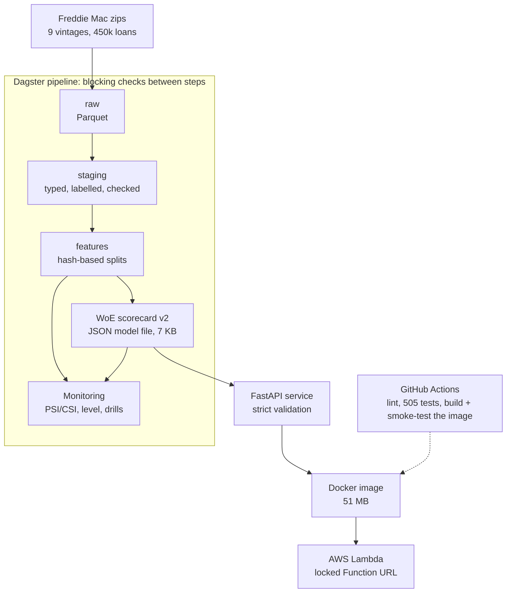

# Credit Risk Platform: an honestly validated mortgage-default model, served on AWS

[](https://github.com/Aymannel04/credit-risk-platform/actions/workflows/ci.yml)

An end-to-end credit-risk project on real, public mortgage data (Freddie Mac): a reproducible data pipeline, an interpretable scorecard compared with XGBoost, a strict scoring API running in a container on AWS Lambda, and monitors whose alarms were themselves tested.

> **Not a lending product.** A portfolio project on public data, with no claim about any real lender and no regulatory-compliance claim.

**The idea of the project is not a high score. It is trying to catch myself being wrong.** The model was frozen and the success rules were written down *before* it was tested on years it had never seen; every flaw I found is documented rather than hidden.

## Results at a glance (all numbers come from the files in `results/`)

| What | Result |
|---|---|
| Data | Freddie Mac single-family loan-level samples, 9 origination years, 450,000 loans (the data itself is not in this repo: Freddie Mac terms) |
| **Exam on 4 unseen years** (2010, 2014, 2018, 2023; 177,081 loans; model frozen and rules pre-registered) | Gini **0.628 / 0.599 / 0.543 / 0.595** for the recommended scorecard v2 (95% bootstrap intervals in `results/v2_exam.md`) |
| Does the improved v2 beat v1? | Mean Gini difference **+0.024** (95% CI +0.013 to +0.035), meeting the pre-registered rule |
| Interpretable scorecard vs XGBoost | No statistically significant difference (`results/final_exam.md`): the readable model wins on explainability |
| **A flaw found on purpose** | In calm years the model predicts **1.4 to 2.6 times** more defaults than happen (the 2008 crisis anchors its level). It is measured, monitored, and documented in `/model-info` |
| A tempting fix, tested | Re-centring the level from past years reduced the average error by 31% but made turning points worse (+0.65): **rejected by a rule written beforehand** |
| "Why not just delete 2008?" (exploratory) | Calm years look better, but the crisis is then under-predicted about 4 times: the plain average hides the cost (`results/exploratory_without_2008.md`) |
| Monitoring | PSI/CSI and level monitors; fire drills with simulated shifts: **7 of 7** expected alerts caught, 2 subtle shifts missed and reported (`results/monitoring_report.md`) |
| Pre-registered predictions | 11 of 13 hit for the monitoring study; the misses are published |
| Live API on AWS Lambda (measured) | Warm request **2.7 ms** median (p95 3.0 ms); cold start about **1.2 to 1.3 s**; **78 MB** used of 512 MB; 71 invocations observed (`results/lambda_latency.md`) |
| Memo agent (read-only) | An inspector rejected **150 of 150** deliberately damaged memos (pretend writers, 10 kinds of mistake). A small free language model (Llama 3.2 11B), on **20 loans never looked at while tuning**: **18 memos accepted on the first try, 1 after a rewrite, 1 backup memo written by code, 0 of 23 tries rejected for a wrong number, a wrong decision or a promise** (`results/agent_eval_llama11b_v3_fresh_fr.md`, with its limits) |
| Engineering | 505 automated tests; CI also builds the container and smoke-tests it; a full rebuild from the raw files reproduces the same data and the same model (checked by a fingerprint of every row and the model id) |


## Architecture



| Part | What it does | Where |
|---|---|---|
| Data layers | raw → staging → features, with data-quality guards and leakage tests | `credit/freddie/` |
| Models | WoE scorecard, logistic regression, XGBoost, calibration, bootstrap intervals | `credit/models/` |
| Honest evaluation | freeze and pre-registration; guarded exam scripts that refuse to run unless the freeze is committed | `credit/models/freeze.py`, `docs/*preregistration.md` |
| Money and fairness | cut-off from margin and loss assumptions, slice analysis (limits stated) | `credit/economics/`, `results/` |
| Model file | the scorecard as a 7 KB JSON; a standard-library-only scorer; reason codes in fixed sentences | `credit/serving/`, `models/scorecard_v2.json` |
| API | `/health`, `/model-info`, `/score`, `/explain`; strict input; never decides approve/refuse; stores nothing | `service/` |
| Pipeline | one command, up-to-date steps skipped, blocking checks | `pipeline/` (Dagster) |
| Monitoring | PSI/CSI, observed/predicted level, simulated-shift drills | `credit/monitoring/` |
| Cloud | container, ECR, Lambda, least-privilege role, locked URL; private S3 data lake read by Athena; scripts with dry-run and teardown | `Dockerfile`, `infra/`, `credit/cloud/` |
| Memo agent | code asks the API and decides approve / refer / decline; a language model only writes; an inspector checks every number; a memo written by code is the fallback | `agent/` |
| Transformations as dbt | the same cleaning and features as models with 43 tests; three parity tests prove the tables are identical to the pipeline's (450,000 loans) | `dbt/` |
| Spark check | the same cleaning and features in PySpark on Delta tables (Databricks Free Edition): identical tables and 6 of 6 control queries; Spark took 35 s against 1.8 s for DuckDB at this size | `databricks/`, `results/spark_parity.md` |

## What runs on AWS

The scoring API runs as a container image on **AWS Lambda** (eu-north-1) behind a **Function URL locked with `AWS_IAM`**: every request must be signed, so an anonymous visitor gets `403 Forbidden`. The function's role can write its own logs and nothing else. Infrastructure is created by PowerShell scripts in `infra/` that have a `-DryRun` mode, are safe to run twice, and come with a teardown. Images are tagged with the git commit and immutable.

**Measured on the live function (2026-10-13, 71 invocations):** a warm request takes **2.7 ms** of compute (median; p95 3.0 ms); a **cold start** (a new container is prepared) adds about **1.2 to 1.3 s** (2 observed); memory used **78 MB of 512 MB**. From my laptop the full round trip to Stockholm, including the internet and a fresh TLS handshake per call, is **0.68 s median (p95 1.5 s)**: that part is the network, not the function. Details and caveats: `results/lambda_latency.md`.

**Data lake (S3 + Athena).** The pipeline's Parquet tables (20 files, 261.7 MB: raw originations, the 24.7 million monthly rows, and the model-ready feature tables) are copied to a **private S3 bucket** (all public access blocked, encrypted, versioned, HTTPS only, cleanup rules) and described to **Athena** through a Glue database. The Athena workgroup **cancels any query that would scan more than 200 MB**. A parity test runs the same 6 SQL queries on the local DuckDB and on Athena: **6 of 6 gave identical answers** (counts and sums exact), and the whole test scanned about 6 MB (`results/lake_parity.md`). Files are uploaded only when their checksum changed. The upload is a script (`scripts/lake_sync.py`) and an opt-in Dagster step (`CREDIT_LAKE=1`), not yet part of an automatic deployment; the API does not read from the lake.

**Automatic deployment (GitHub Actions + OIDC, no stored keys).** A push to `main` runs lint, the tests, the image build, a check of the image's exact file list and a container smoke test, all **without any AWS access**. Only then does the job show GitHub's signed ID card to AWS and receive a temporary key (about an hour). The role behind it trusts one repository on one branch (matched on the owner's and the repository's permanent numeric ids) and may only push to one ECR repository and update one Lambda function; AWS's policy simulator was asked to prove 3 allowed and 7 forbidden actions. The job then pushes the image tagged with the git commit, updates the function, checks that the function runs exactly the pushed image digest, and calls the live locked URL with signed requests. First fully green run (Deploy #3): 162 s in total (tests 30 s, image build 13 s, temporary key 2 s, push 19 s, Lambda update 15 s, live check 8 s).

There is no public demo URL on purpose (it would need a spending guard); a recorded demo is planned. The old Streamlit demo of v1 is still at https://creditscoringproject.streamlit.app/.

## The memo agent

A read-only agent drafts a short credit memo (French or English) for one loan. **Code does everything that matters**: it asks the scoring API (its only tool, a POST to `/explain`), computes the recommendation (approve, refer to a human, decline) from two lines in `config/memo_policy.yaml` (an illustrative assumption, not a lending policy), and builds a fact sheet. **The language model only words the memo.** An **inspector** (plain code, ten checks) reads every number with its sign, the decision word, the six headings, the fixed warnings and the forbidden promises; a rejected memo goes back to the model with a list of complaints (at most 2 rewrites), and if it still fails the memo **written by code** is used, flagged "LLM memo rejected". The section with the loan's own numbers is always written by code. The writer is any service that speaks the OpenAI chat format; the key lives in an environment variable and is never written anywhere.

| Real-model run (Llama 3.2 11B, free NVIDIA Build service, French) | Loans | First try | After a rewrite | Backup memo |
|---|---|---|---|---|
| Instructions v1, the 15 loans used while building | 15 | 11 | 2 | 2 |
| Instructions v2, the same 15 loans (a tuning score, not a result) | 15 | 14 | 1 | 0 |
| Instructions v2, 20 random loans (held-out) | 20 | 12 | 3 | 5 |
| **Instructions v3, 20 other random loans (fresh): the reported result** | 20 | **18** | 1 | 1 |

The drop from 14 of 15 to 12 of 20 is overfitting to the loans I had looked at, which is why a second, never-seen set exists. On that set, **0 of 23 tries were rejected for safety** (all 4 complaints were a memo 1 to 5 words over the 260-word limit); the typical memo took 19 s (median; mean 44 s, slowest 177 s: the free service is shared). With 20 loans the 95% interval for "accepted on the first try" is 70% to 97%, and the improvement from v2 to v3 is suggested, not proven (different loans). The evidence for every failed loan, the bugs the held-out loans found in my own code (negative numbers, a decision word matching "Reference") and the whole story are in `docs/decision-log.md`.

## Honest limitations

- **The level is wrong in calm years** (1.4 to 2.6 times too high), because the model is through-the-cycle and the data holds only about 9 distinct economies. A Vasicek-style "climate dial" or a house-price variable are the planned fixes, not done.
- The target is a **flagged serious delinquency within 24 months**, not a loss. Prime US fixed-rate mortgages only.
- `rate_spread` needs a reliable reference rate from the caller.
- The money analysis rests on **assumed** margin and loss rates (`config/economics.yaml`); the cut-off barely beats "approve everyone" on prime mortgages. No sex, race or age exists in the data, so fairness toward protected groups could not be tested.
- Deployment is **automatic but has no automatic rollback**: a push to `main` deploys (see above). If the final live check fails, the run turns red and the previous image (the last 3 are kept) must be put back by hand with two commands. The infrastructure itself (ECR, Lambda, the lake) is still created by scripts run by hand.
- Monitors use my own PSI/CSI code (not Evidently), and two subtle shifts are invisible to them (reported).
- **The memo agent** was measured with one small free model, in French, on made-up loans, 20 per set (wide intervals). In the free text the inspector checks that a number is on the sheet, not which fact it belongs to (the loan-data section is written by code to cover this). The rewrite barely helps a model this small (it tends to copy its memo back). It runs from a command line and is not deployed on AWS.
- The AWS account is on the Free plan, which ends in about six months; the live API will then disappear.

## Run it

Data: download the Freddie Mac samples yourself (free registration) into `data/raw/freddie/`; they are git-ignored and never committed.

```bash
python -m venv .venv
.venv/Scripts/python -m pip install -r requirements-dev.txt      # Linux/macOS: .venv/bin/python

.venv/Scripts/python -m pipeline.run            # data, features, model file, monitoring report (steps already up to date are skipped)
.venv/Scripts/python -m pytest -q               # 505 tests
.venv/Scripts/python -m ruff check .

# the API
.venv/Scripts/python -m uvicorn service.main:create_app --factory --reload     # then open http://127.0.0.1:8000/docs

# the container (Docker Desktop running)
docker build -t scoring-api:local .
docker run --rm -p 8080:8080 scoring-api:local
.venv/Scripts/python scripts/smoke_test_api.py --url http://127.0.0.1:8080 --wait 60
```

## Where to read more

| If you want | Read |
|---|---|
| The whole project one part at a time: where it fits, why, how, how it works (with pictures) | [`docs/walkthrough/`](docs/walkthrough/README.md) |
| A plain-language tour from zero (no finance background needed) | [`docs/guide/`](docs/guide/README.md) |
| Every decision with its evidence, including bugs found and wrong turns | [`docs/decision-log.md`](docs/decision-log.md) |
| The model in one page, with its limits | [`docs/model_card.md`](docs/model_card.md) |
| The rules written before the tests | [`docs/v2_preregistration.md`](docs/v2_preregistration.md), [`docs/monitoring_preregistration.md`](docs/monitoring_preregistration.md) |
| How the cloud part is built and undone | [`infra/README.md`](infra/README.md) |
| The original v1 project (German Credit, SMOTE, Streamlit) | [`docs/v1_project.md`](docs/v1_project.md) and https://github.com/Aymannel04/credit_scoring_project |

## Stack

Python 3.13 · pandas · DuckDB · Parquet · scikit-learn · XGBoost · SHAP · Dagster · FastAPI · Pydantic · Docker · AWS (Lambda, ECR, IAM, CloudWatch, S3, Glue, Athena) · OpenAI-compatible LLM API (NVIDIA Build, Llama 3.2 11B) · GitHub Actions · pytest · ruff

## Status

A working first version: data to model to a live, locked API with automatic deployment from GitHub (no stored keys), a private S3 + Athena data lake, and tested monitors, plus a read-only memo agent whose memos are checked number by number. Next steps (a position-aware inspector, the agent behind the API, an automatic rollback) are in the decision log; the original roadmap is in [`docs/technical-sheet.md`](docs/technical-sheet.md).
