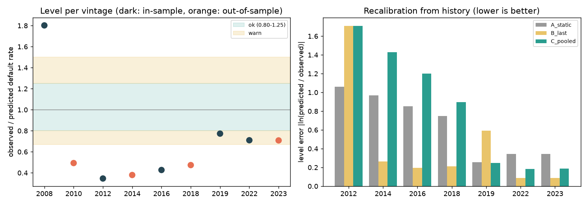

# Credit Risk Platform: an honestly validated mortgage-default model, served on AWS

[](https://github.com/Aymannel04/credit-risk-platform/actions/workflows/ci.yml)

An end-to-end credit-risk project on real, public mortgage data (Freddie Mac): a reproducible data pipeline, an interpretable scorecard compared with XGBoost, a strict scoring API running in a container on AWS Lambda, and monitors whose alarms were themselves tested.

> **Not a lending product.** A portfolio project on public data, with no claim about any real lender and no regulatory-compliance claim.

**The idea of the project is not a high score. It is trying to catch myself being wrong.** The model was frozen and the success rules were written down *before* it was tested on years it had never seen; every flaw I found is documented rather than hidden.

## Results at a glance (all numbers come from the files in `results/`)

| What | Result |
|---|---|
| Data | Freddie Mac single-family loan-level samples, 9 origination years, 450,000 loans (the data itself is not in this repo: Freddie Mac terms) |
| **Exam on 4 unseen years** (2010, 2014, 2018, 2023; 177,081 loans; model frozen and rules pre-registered) | Gini **0.628 / 0.599 / 0.543 / 0.595** for the recommended scorecard v2 (95% bootstrap intervals in `results/v2_exam.md`) |
| Does the improved v2 beat v1? | Mean Gini difference **+0.024** (95% CI +0.013 to +0.035), meeting the pre-registered rule |
| Interpretable scorecard vs XGBoost | No statistically significant difference (`results/final_exam.md`): the readable model wins on explainability |
| **A flaw found on purpose** | In calm years the model predicts **1.4 to 2.6 times** more defaults than happen (the 2008 crisis anchors its level). It is measured, monitored, and documented in `/model-info` |
| A tempting fix, tested | Re-centring the level from past years reduced the average error by 31% but made turning points worse (+0.65): **rejected by a rule written beforehand** |
| "Why not just delete 2008?" (exploratory) | Calm years look better, but the crisis is then under-predicted about 4 times: the plain average hides the cost (`results/exploratory_without_2008.md`) |
| Monitoring | PSI/CSI and level monitors; fire drills with simulated shifts: **7 of 7** expected alerts caught, 2 subtle shifts missed and reported (`results/monitoring_report.md`) |
| Pre-registered predictions | 11 of 13 hit for the monitoring study; the misses are published |
| Engineering | 240 automated tests; CI also builds the container and smoke-tests it; a full rebuild from the raw files reproduces the same data and the same model (checked by a fingerprint of every row and the model id) |



## Architecture


| Part | What it does | Where |
|---|---|---|
| Data layers | raw → staging → features, with data-quality guards and leakage tests | `credit/freddie/` |
| Models | WoE scorecard, logistic regression, XGBoost, calibration, bootstrap intervals | `credit/models/` |
| Honest evaluation | freeze and pre-registration; guarded exam scripts that refuse to run unless the freeze is committed | `credit/models/freeze.py`, `docs/*preregistration.md` |
| Money and fairness | cut-off from margin and loss assumptions, slice analysis (limits stated) | `credit/economics/`, `results/` |
| Model file | the scorecard as a 7 KB JSON; a standard-library-only scorer; reason codes in fixed sentences | `credit/serving/`, `models/scorecard_v2.json` |
| API | `/health`, `/model-info`, `/score`, `/explain`; strict input; never decides approve/refuse; stores nothing | `service/` |
| Pipeline | one command, up-to-date steps skipped, blocking checks | `pipeline/` (Dagster) |
| Monitoring | PSI/CSI, observed/predicted level, simulated-shift drills | `credit/monitoring/` |
| Cloud | container, ECR, Lambda, least-privilege role, locked URL; scripts with dry-run and teardown | `Dockerfile`, `infra/` |

## What runs on AWS

The scoring API runs as a container image on **AWS Lambda** (eu-north-1) behind a **Function URL locked with `AWS_IAM`**: every request must be signed, so an anonymous visitor gets `403 Forbidden`. The function's role can write its own logs and nothing else. Infrastructure is created by PowerShell scripts in `infra/` that have a `-DryRun` mode, are safe to run twice, and come with a teardown. Images are tagged with the git commit and immutable.

Latency and memory, measured on the live function: see `results/lambda_latency.md` (**TBD until `scripts/measure_latency.py` has been run; no estimate is quoted here**).

There is no public demo URL on purpose (it would need a spending guard); a recorded demo is planned. The old Streamlit demo of v1 is still at https://creditscoringproject.streamlit.app/.

## Honest limitations

- **The level is wrong in calm years** (1.4 to 2.6 times too high), because the model is through-the-cycle and the data holds only about 9 distinct economies. A Vasicek-style "climate dial" or a house-price variable are the planned fixes, not done.
- The target is a **flagged serious delinquency within 24 months**, not a loss. Prime US fixed-rate mortgages only.
- `rate_spread` needs a reliable reference rate from the caller.
- The money analysis rests on **assumed** margin and loss rates (`config/economics.yaml`); the cut-off barely beats "approve everyone" on prime mortgages. No sex, race or age exists in the data, so fairness toward protected groups could not be tested.
- Deployment is **scripted, not yet automatic**: CI builds and tests the image, but pushing it to AWS is done by `infra/` scripts run by hand (GitHub OIDC deployment is the next step).
- Monitors use my own PSI/CSI code (not Evidently), and two subtle shifts are invisible to them (reported).
- The AWS account is on the Free plan, which ends in about six months; the live API will then disappear.

## Run it

Data: download the Freddie Mac samples yourself (free registration) into `data/raw/freddie/`; they are git-ignored and never committed.

```bash
python -m venv .venv
.venv/Scripts/python -m pip install -r requirements-dev.txt      # Linux/macOS: .venv/bin/python

.venv/Scripts/python -m pipeline.run            # data, features, model file, monitoring report (steps already up to date are skipped)
.venv/Scripts/python -m pytest -q               # 240 tests
.venv/Scripts/python -m ruff check .

# the API
.venv/Scripts/python -m uvicorn service.main:create_app --factory --reload     # then open http://127.0.0.1:8000/docs

# the container (Docker Desktop running)
docker build -t scoring-api:local .
docker run --rm -p 8080:8080 scoring-api:local
.venv/Scripts/python scripts/smoke_test_api.py --url http://127.0.0.1:8080 --wait 60
```

## Where to read more

| If you want | Read |
|---|---|
| A plain-language tour from zero (no finance background needed) | [`docs/guide/`](docs/guide/README.md) |
| Every decision with its evidence, including bugs found and wrong turns | [`docs/decision-log.md`](docs/decision-log.md) |
| The model in one page, with its limits | [`docs/model_card.md`](docs/model_card.md) |
| The rules written before the tests | [`docs/v2_preregistration.md`](docs/v2_preregistration.md), [`docs/monitoring_preregistration.md`](docs/monitoring_preregistration.md) |
| How the cloud part is built and undone | [`infra/README.md`](infra/README.md) |
| The original v1 project (German Credit, SMOTE, Streamlit) | [`docs/v1_project.md`](docs/v1_project.md) and https://github.com/Aymannel04/credit_scoring_project |

## Stack

Python 3.13 · pandas · DuckDB · Parquet · scikit-learn · XGBoost · SHAP · Dagster · FastAPI · Pydantic · Docker · AWS (Lambda, ECR, IAM, CloudWatch) · GitHub Actions · pytest · ruff

## Status

A working first version: data to model to a live, locked API, with tested monitors. Next: automatic deployment through GitHub OIDC (no stored keys), an S3 data lake with an Athena parity test, and a small read-only LLM memo agent. See the roadmap in [`docs/technical-sheet.md`](docs/technical-sheet.md).
