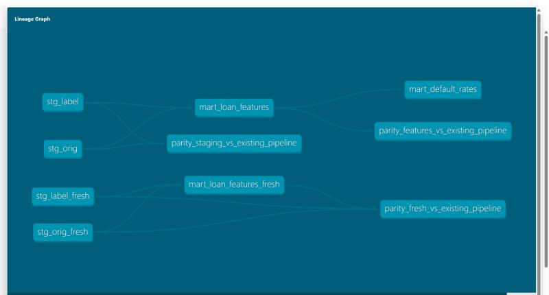

# dbt project: the data transformations as tested, documented models

The pipeline (`credit/freddie/*.py`) cleans the raw Freddie Mac files and builds the table the models learn from, with DuckDB. This folder
does the **same transformations with dbt**: one SQL model per table, tests next to them, a lineage graph.

```
raw Parquet --> stg_orig, stg_label (typed, labelled)  --> mart_loan_features (kept loans, features, split) --> mart_default_rates
raw Parquet (4 fresh vintages) --> stg_orig_fresh, stg_label_fresh --> mart_loan_features_fresh
```



## Why

- **Models and tests live together.** `not_null`, `unique`, `accepted_values`, `relationships` and a custom `in_range` test mirror the checks of `credit/freddie/staging.py`; a failing test stops `dbt build` before the next layer.
- **"Test your work instead of assuming it is right."** Three `parity_*` tests compare the dbt tables with the Parquet files written by the Python pipeline (rows that exist on one side only make the test fail). Result: identical on all 9 vintages.
- **Not a rewrite for show:** the SQL is the SQL of `staging.py` and `features.py`; the helpers (`_int`, `_one_of`, `_month`) became dbt macros (`macros/`).

## Run it (from this folder)

```powershell
..\..\.venv\Scripts\python.exe -m pip install -r ..\..\requirements-dbt.txt
..\..\.venv\Scripts\dbt.exe build --profiles-dir .          # models + tests
..\..\.venv\Scripts\dbt.exe docs generate --profiles-dir .
..\..\.venv\Scripts\dbt.exe docs serve --profiles-dir . --port 8085
```

It needs the Freddie Mac Parquet files in `data/interim/` (built by the pipeline; never in git). The result lives in `target/credit.duckdb` (ignored by git).

## Measured (2026-10-21, on the owner's laptop, DuckDB)

| What | Value |
|---|---|
| Models / tests | 7 models, 43 tests, all pass |
| Loans staged | 450,000 (250,000 main vintages + 200,000 fresh) |
| Rows in the features tables | 229,419 (main) and 177,081 (fresh), identical to the pipeline's files |
| `dbt build` | about 4 seconds of running (8 with start-up) |
| Negative test | a wrong split seed made the parity test fail with 151,442 differing rows |

## Limits

- The profile is local (DuckDB). A Databricks target is a possible next step; nothing here depends on it.
- The raw files are read directly (`read_parquet`), not declared as dbt sources.
- dbt is optional: the project's CI does not install it (the 7 structure tests in `tests/test_dbt_project.py` run without it; the data tests run on the owner's machine).
