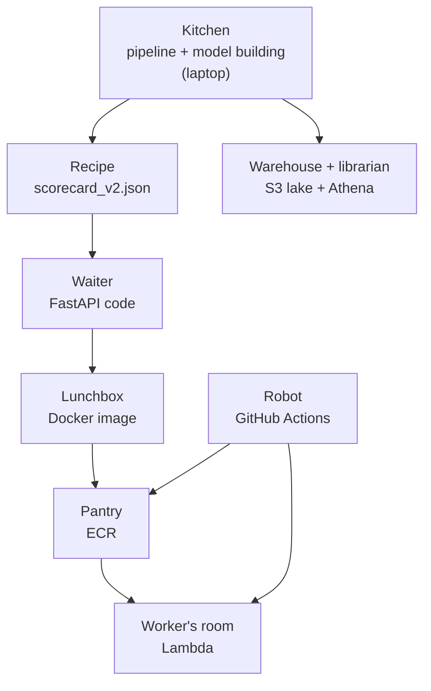

# The Big Picture and Architecture

**Status:** built and measured (data to model to live locked API, automatic deploy, data lake). The read-only memo agent is built (command line, file 12).

## 1. Where it fits (workflow and architecture)

This is the first file. It shows the whole project as a restaurant.

Before this file: nothing. After it: file 02 (the data that goes into the kitchen).

Words to know:
- **Mortgage**: a loan to buy a home. The bank lends, the borrower repays month by month.
- **Default**: the borrower stops paying. The exact rule used here is in file 03.
- **PD** (probability of default): the chance that a loan defaults. A number from 0 to 1, or 0% to 100%.
- **Scorecard**: a points table. Each fact about the borrower gives points. More points = safer.
- **Model file**: the scorecard saved as a small file. This is the recipe.

## 2. Why we did it

The problem: a bank must guess, before lending, how likely a borrower is to default.

The idea of the project is not a high score. It is to try to catch myself being wrong (`README.md`).
So the model was frozen and the success rules were written down before the exam (file 03).

Choices and what was rejected (from `docs/decision-log.md`):
- **Data.** Kaggle "Home Credit" was rejected: its rules allow the data only for that competition (2026-10-08). Freddie Mac was chosen: real dates, real loss data, free sample.
- **Cloud.** Google Cloud was the first plan. Its billing setup failed with an error, so AWS was used (2026-10-09).
- **Local first.** The data stays on the laptop. The cloud layer is thin.
- **Athena** (a tool to run SQL on files in S3) is not needed for this data size. DuckDB (a SQL engine that runs on the laptop) does it in seconds. Athena was kept only for a parity test (file 11).
- **One recorded run on ECS Fargate** (a cloud service for containers) was planned on 2026-10-11. The repo does not show it done. Not claimed.

## 3. How we did it

The repo folders (all names from the repo):

| Folder or file | Role in the restaurant |
|---|---|
| `credit/freddie/` | Kitchen: raw, staging, features (file 02) |
| `credit/models/` | Kitchen: scorecard, XGBoost, calibration, exams (files 03, 04) |
| `credit/economics/`, `credit/models/fairness.py`, `credit/models/reasons.py` | Money, fairness, reasons (file 05) |
| `credit/monitoring/` | Dashboard (file 06) |
| `pipeline/` | The kitchen routine, Dagster (file 07) |
| `credit/serving/`, `models/scorecard_v2.json`, `service/` | Recipe and waiter (file 08) |
| `Dockerfile`, `infra/`, `.github/workflows/` | Lunchbox, AWS scripts, robot (files 09, 10) |
| `credit/cloud/lake.py`, `scripts/lake_sync.py` | Warehouse and librarian (file 11) |
| `tests/` | 308 tests |
| `results/`, `docs/` | Measured results and writing |

Commands you will meet (from `CLAUDE.md` and `README.md`):
- Run the kitchen: `.venv/Scripts/python -m pipeline.run`
- Run the tests: `.venv/Scripts/python -m pytest -q`
- Run the waiter on the laptop: `.venv/Scripts/python -m uvicorn service.main:create_app --factory --reload`

## 4. How it works

Follow one made-up loan, the "golden loan" used in tests (`scripts/smoke_test_api.py`):
credit score 700, debt-to-income 44, loan-to-value 85, one borrower, purchase, 30-year term.

1. The kitchen (laptop) read Freddie Mac loans and built the recipe long before this loan arrived.
2. The recipe is a table of bands and points. The golden loan falls in one band per fact.
3. The waiter (FastAPI) receives the loan as JSON. JSON is a plain text format for data. The waiter checks every field strictly.
4. The waiter adds the points. The golden loan gets 553.3 points. A formula turns points into a PD: 9.17%.
5. The waiter also gives reasons in fixed sentences. The top three are credit score, combined loan-to-value, debt-to-income.
6. In the cloud, the sleeping worker (Lambda) wakes up when the signed request knocks on the locked door. The waiter lives inside the worker's lunchbox.
7. The robot (GitHub Actions) puts a new lunchbox in the pantry (ECR) and swaps it into the worker's room on every push to `main`.

## 5. Useful notes

- **Honest limits** (`README.md`, "Honest limitations"): in calm years the model predicts 1.4 to 2.6 times more defaults than happen. The target is a serious late payment, not a loss. Prime US fixed-rate mortgages only.
- **Not built:** the memo agent behind the API or on AWS, automatic rollback, the API reading from the lake, live monitoring, a public demo URL.
- **Not a lending product.** It is a portfolio project on public data.
- **Measured live numbers** (`results/lambda_latency.md`): warm request 2.7 ms median, cold start about 1.2 to 1.3 s, 78 MB used of 512 MB.
- **Deploy** (`docs/decision-log.md`, 2026-10-16): Deploy #3 took 162 s in total.
- The Free plan of the AWS account ends in about six months (around April 2027, exact day not read in the repo). The live API will then disappear (`README.md`).
- Deeper reading: `docs/guide/01_the_basics.md`, `docs/guide/10_serving_and_monitoring.md`.

## 6. Never forget (one sentence)

The kitchen builds a small recipe on the laptop, the waiter serves it from a sleeping worker in AWS, and the robot swaps the lunchbox on every push.

Recall question: in this project, where does the model get built and where does it get served?

## Answer

It is built on the laptop (the kitchen: pipeline and model building) and served on AWS Lambda (the worker's room), inside a Docker image (the lunchbox) with the FastAPI waiter and the 7 KB recipe `models/scorecard_v2.json`.
