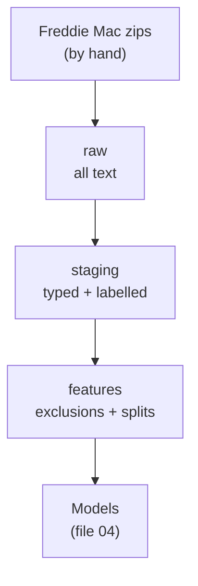

# The Data and the Medallion Layers

**Status:** built and measured.

## 1. Where it fits (workflow and architecture)

This is the start of the kitchen. Raw ingredients arrive, then they are washed, then they are cut into portions.

Before this file: the big picture (file 01). After it: the target and honest testing (file 03).

Words to know:
- **Freddie Mac**: a US company that buys mortgages. It publishes loan-level data for free (after registration).
- **Vintage**: all loans started in one year. "Vintage 2016" = loans from 2016.
- **Parquet**: a file format for tables. It stores columns together. It is small and fast.
- **DuckDB**: a SQL engine that runs on the laptop and reads Parquet.
- **Medallion layers**: a pattern with three layers (bronze, silver, gold). Here they are called raw, staging and features. Each layer reads only the one before.
- **Leakage**: a model sees information it could not know at decision time. It looks great in tests and fails in real life.

## 2. Why we did it

- Real data with real dates gives a real out-of-time test and real drift between years (`docs/decision-log.md`, 2026-10-08).
- Freddie Mac also has real loss data. So the loss given default (file 05) can be measured, not guessed.
- The terms forbid giving the data to others. So the raw data is never in git, never in a public bucket, never shown row by row.
- Separate layers make bugs easy to place. If a number is wrong, you know which layer to blame, and you can rebuild one layer.
- A first profiling query once dropped loans by mistake. In SQL, a comparison with NULL (a missing value) gives NULL, not true or false. Two columns looked identical in every year, and that exposed it. Rule since then: wrap nullable comparisons in `COALESCE`.

## 3. How we did it

Files and commands (from the repo):
- Layout of the columns: `credit/freddie/layout.py`. Tests: `tests/test_freddie_layout.py`.
- Raw: `python -m credit.freddie.load <years>` (`credit/freddie/load.py`). Input: `data/raw/freddie/` (git-ignored).
- Staging: `python -m credit.freddie.staging <years>` (`credit/freddie/staging.py`). Output: `data/interim/stg/`.
- Features: `python -m credit.freddie.features` (`credit/freddie/features.py`). Output: `data/interim/features/features.parquet`.
- Fresh (exam) years: `python -m credit.freddie.fresh`. Kept in a separate folder `data/interim/stg_fresh/`.
- In practice you run all of it with one command: `python -m pipeline.run` (file 07).

## 4. How it works

**Two tables per loan.** The origination file has the loan on day one (31 fields in the real sample files, the guide says 32). The performance file has one row per month (35 fields). They join on `loan_seq`. Files are named `sample_orig_YYYY.txt` and `sample_perf_YYYY.txt`.

**Nine samples of 50,000 loans.** Development years: 2008, 2012, 2016, 2019, 2022. Fresh (exam) years: 2010, 2014, 2018, 2023. Total 450,000 loans and 24,674,152 monthly rows (`docs/decision-log.md`, 2026-10-16).

**Raw.** Everything is kept as text, with column names added. The delinquency status is text because it contains letters such as `RA`.

**Staging.** It types the columns. Special values become missing: credit score `9999`, ratios `999`, units or borrowers `99`, first-time buyer `9`. It builds the label (file 03). It flags relief refinance and seasoned/modified loans but removes nothing. Checks that stop the run: unique `loan_seq`, no performance row without an origination row, value ranges, at most 1% missing credit scores, labels only 0 or 1, default rate between 0 and 20%, and a leakage test.

**Features.** It removes loans, in this order, and counts them per vintage:
1. Relief refinance loans (a special government programme).
2. Seasoned or modified loans (their clock does not start at origination).
3. Loans not observable for 24 months (their label would be unknown).

| Vintage | Relief refi removed | Seasoned/modified removed | Kept |
|---|---|---|---|
| 2008 | 0 | 287 | 49,712 |
| 2012 | 17,399 | 55 | 32,546 |
| 2016 | 2,525 | 103 | 47,372 |
| 2019 | 30 | 89 | 49,881 |
| 2022 | 0 | 22 | 49,907 |

(Source: `docs/decision-log.md`, 2026-10-09; one odd 2009 loan in the 2008 file is kept too. Development table: 229,419 rows. Fresh table: 177,081 rows.)

**Model inputs** are day-one facts only. Numeric: credit score, MI percentage, units, CLTV, DTI, original amount, LTV, rate spread, term, borrowers. Categorical: first-time buyer, occupancy, channel, prepayment flag, property type, purpose, state, super-conforming.
`rate_spread` = the loan's interest rate minus the median rate of loans of the same quarter and term. It replaced the raw rate, which mostly says "which year".

**Hash-based splits.** Each loan gets a number from 0 to 99: `hash(loan_seq || 'split-v1') % 100`. For vintages up to 2018: below 60 = train, below 70 = calibration, below 85 = validation, else test_in_time. Vintages 2019 to 2021 = `test_oot_2019`. Vintages 2022 and later = `test_oot_2022`. "OOT" means out of time.

| Split | Loans | Defaults | Default rate |
|---|---|---|---|
| train | 78,007 | 1,566 | 2.01% |
| calibration | 13,064 | 248 | 1.90% |
| validation | 19,129 | 391 | 2.04% |
| test_in_time | 19,431 | 375 | 1.93% |
| test_oot_2019 | 49,881 | 630 | 1.26% |
| test_oot_2022 | 49,907 | 692 | 1.39% |

Example: loan `X` always gets the same hash. So `X` stays in train forever, even if more data is added. A random split with a seed would reshuffle.

## 5. Useful notes

- Deliberately NOT inputs: zip3, msa (geography), seller name, programme indicator, vintage year, maturity date. See `credit/freddie/features.py`.
- Test splits are locked in code: `credit/models/data.py` refuses them unless `allow_test=True`. Fresh labels are locked by `allow_exam` in `credit/freddie/fresh.py`.
- Relief refinance removed 35% of the 2012 sample (17,399 loans). This is a notable choice (`docs/decision-log.md`).
- A staging guard once rejected a real 513-month loan. The limit (480) was my own assumption. It is now 60 to 600 months, with a test on both sides.
- Honest limit: samples of 50,000 per year, not the full dataset.
- Tests: `tests/test_staging.py`, `tests/test_features.py`, `tests/test_fresh.py`.
- Deeper reading: `docs/guide/02_data_and_pipeline.md`.

## 6. Never forget (one sentence)

Raw keeps the data as received, staging cleans and labels it, features removes the wrong loans and deals each loan to train or test by a fixed hash.

Recall question: why is the split done with a hash of the loan id and not with a random draw?

## Answer

Because a hash gives the same answer every time, so adding or reloading data never moves an old loan from train to test.
