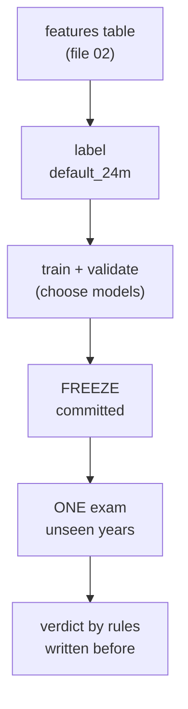

# The Target, the Labels and Honest Testing

**Status:** built and measured.

## 1. Where it fits (workflow and architecture)

This part decides what the model must predict, and how we stop ourselves from cheating.

Before: data layers (file 02). After: the models themselves (file 04).

Words to know:
- **Label**: the right answer for each loan in the past (1 = defaulted, 0 = did not).
- **Out of time**: tested on years that come after the training years.
- **Gini**: a score for ranking. 0 = coin flip, 1 = perfect. It is `2 x AUC - 1` (`credit/models/metrics.py`). AUC is the chance that a random defaulter gets a riskier score than a random good loan.
- **Freeze**: write down everything that defines the exam (models, settings, fingerprints of files), and commit it to git before the exam.
- **Pre-registration**: write down the predictions and the success rules before seeing results.
- **Bootstrap**: re-draw the loans many times to see how much a number would wobble. It gives a 95% interval.

## 2. Why we did it

- Freddie Mac's guide does not define "default". The definition is this project's own assumption (`docs/decision-log.md`, 2026-10-09).
- A model that looks great in testing can fail in the real future. The skill is to test honestly and say so.
- A quiet danger: if you look at the exam results and then tweak the model, the exam stops being an exam.
- The "era mix" finding: the baseline's pooled validation Gini of 0.826 looked too good because it mixed years. It partly recognised the year (high rates, crisis) instead of judging a borrower. Inside 2016 only, the Gini was 0.577 (`docs/decision-log.md`, 2026-10-09).

Three definitions were measured (24-month window, 50,000 loans per sample):

| Definition | Rule | 2008 | 2012 | 2016 | 2019 | 2022 |
|---|---|---|---|---|---|---|
| A | 90+ days late, or a loss event | 4.47% | 0.75% | 0.81% | 4.63% | 1.85% |
| **B (chosen)** | 90+ days late only if no borrower assistance plan is active, or a loss event | 4.46% | 0.74% | 0.66% | 1.26% | 1.52% |
| C | loss event only (zero balance codes 02, 03, 09, 15) | 0.46% | 0.17% | 0.02% | 0.01% | 0.02% |

2019 drops from 4.63% to 1.26% under B. Most of its late loans were in COVID-era forbearance (a paused payment plan), not in credit trouble. C has too few defaults to train on.

## 3. How we did it

- Label code: `credit/freddie/staging.py` (columns `default_24m`, `default_24m_all_late`, `default_24m_loss_only`).
- Freeze v1: `python -m credit.models.freeze` writes `results/frozen_before_exam.json`. Then commit. Then `python -m credit.models.final_exam`.
- Freeze v2: `python -m credit.models.v2_exam freeze`, commit, then `python -m credit.models.v2_exam run`.
- Rules written first: `docs/v2_preregistration.md`, `docs/monitoring_preregistration.md`.
- Guards: `tests/test_final_exam_guard.py`, `tests/test_v2_exam.py`.

## 4. How it works

**The target.** `default_24m = 1` if, within 24 months of the loan's first month, the loan is 90+ days late (or REO, a bank-owned property) while no assistance plan is active, or it ends with zero balance code 02, 03, 09 or 15. Voluntary payoff (01) is 0. Loans without 24 months of history are excluded, so "not yet" is not confused with "never".

**Scope.** An application model: it scores a loan on day one with origination fields only. The monthly file is used only to build the label. That is the leakage rule.

**The freeze.** `freeze.py` stores SHA-256 fingerprints (a hash that changes if one byte changes) of the features file and the config. `final_exam.py` refuses to run if the manifest is missing, not committed, or if the data, config or code changed after it. The refusal was verified.

**One exam, then no tuning.** v1 exam (once, models trained on `train` only; `results/final_exam.md`):

| Exam | Scorecard Gini (95% interval) | Predicted vs real default rate |
|---|---|---|
| in time | 0.735 (0.703-0.769) | 1.97% vs 1.93% |
| out of time 2019 | 0.446 (0.405-0.485) | 1.75% vs 1.26% |
| out of time 2022 | 0.523 (0.487-0.557) | 2.08% vs 1.39% |

No difference between scorecard, logistic regression and XGBoost was significant. Predictions written before: in-time Gini 0.75-0.80 (observed 0.735-0.749, low edge). Out-of-time "a bit lower" was wrong: the drop was much larger.

**Model v2 on fresh years.** The 4 fresh years (2010, 2014, 2018, 2023) had their labels locked. Rules R1 and R2 were fixed first. Result (`results/v2_exam.md`): Gini 0.628 / 0.599 / 0.543 / 0.595. Mean Gini difference v2 minus v1: +0.024 (95% interval +0.013 to +0.035). R1 passed. R2 passed with no margin (4 of 6 slice variables, 4 needed). So v2 became the recommended model.

## 5. Useful notes

- Predictions that were wrong are published: P2 (I rated "superior" under 25%, it was superior) and P4 for 2010 (I said 0.5 to 1.6, observed 1.8 to 2.0) (`docs/decision-log.md`, 2026-10-11).
- After an exam, nothing is tuned. Any later idea is a new, labelled experiment.
- Adding code under `credit/` makes `final_exam` refuse to run again. This is by design (2026-10-10 entry).
- Limit: the assistance-plan field exists only from January 2014. For 2008 the rule cannot exclude anything, so definition B is not symmetric across years.
- Limit: 2010 has only 151 defaults, so its intervals are wide.
- Commit hashes in the older log entries are now only names: the history was rewritten on 2026-10-16 (file 13).
- Deeper reading: `docs/guide/03_how_we_measure_models.md`, `docs/guide/09_model_v2.md`.

## 6. Never forget (one sentence)

Freeze the model, write the rules, run the exam once, and publish the result even when it is bad.

Recall question: what does "freeze" stop you from doing?

## Answer

It stops you from changing the model, data or settings after seeing the exam, because the exam script refuses to run if anything changed since the committed freeze.
