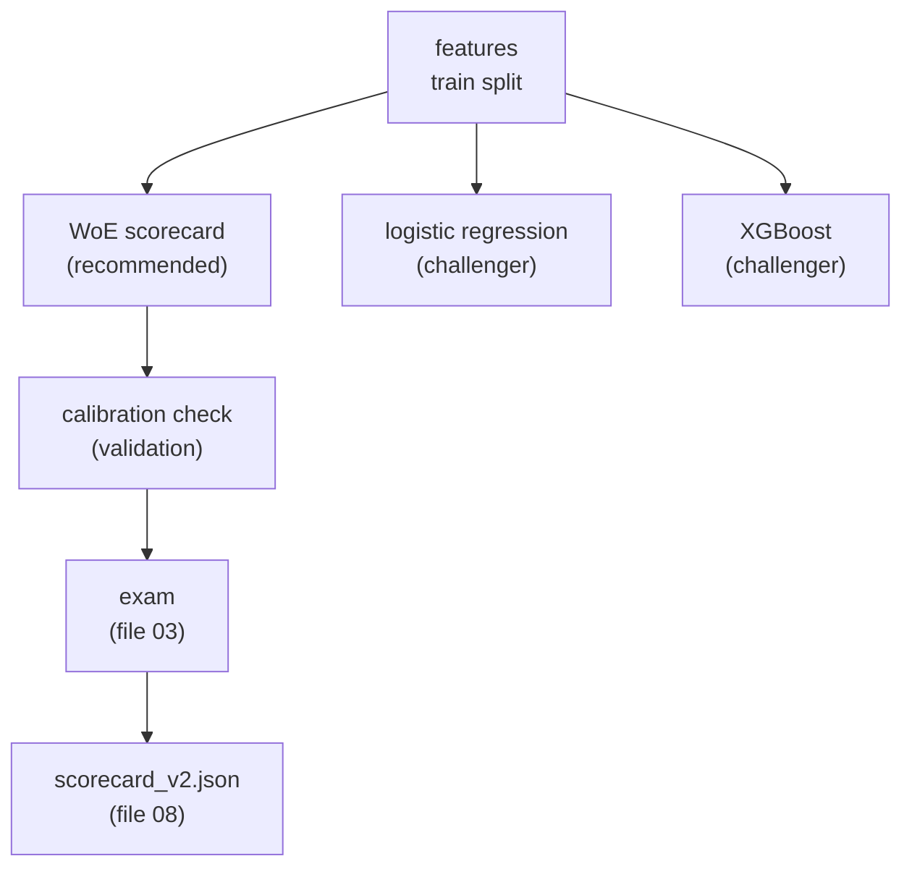

# The Models: Scorecard versus XGBoost

**Status:** built and measured.

## 1. Where it fits (workflow and architecture)

This is the recipe being invented in the kitchen.

Before: label and honest testing (file 03). After: money and fairness (file 05), and the model file (file 08).

Words to know:
- **Band**: a range of a number (credit score 685 to 715) or one category.
- **WoE** (weight of evidence): `ln(share of good loans in the band / share of defaulted loans in the band)`. Above 0 = safer than average. Below 0 = riskier.
- **IV** (information value): how much a feature separates good from bad. Higher = more useful.
- **Logistic regression**: a simple model that gives a probability from weighted inputs.
- **XGBoost**: a model made of many small decision trees. More flexible, harder to read.
- **Calibration**: when the model says 3%, about 3% should really default.
- **Brier score**: the average squared error of the probabilities. Lower is better.
- **KS**: the biggest gap between the cumulative good loans and the cumulative bad loans.

## 2. Why we did it

- A bank must be able to explain a score. A points table is easy to explain and audit.
- XGBoost was tested to see whether the extra power was worth the loss of readability.
- On this data they tie. On validation, pooled AUC was 0.913 for both logistic and XGBoost. With 391 validation defaults, the AUC standard error is about 0.01, so the differences are noise (`docs/decision-log.md`, 2026-10-09).
- The readable model wins on explainability. The cost is at most about 0.01 to 0.02 Gini, inside the noise.
- Class weights and SMOTE (inventing fake defaults) were tested as ablations. Unweighted is the baseline.

## 3. How we did it

- Scorecard: `credit/models/scorecard.py`, report `credit/models/scorecard_report.py`, tests `tests/test_scorecard.py`.
- Challengers: `credit/models/baseline_logreg.py`, `credit/models/xgboost_model.py`.
- Calibration: `credit/models/calibration.py`, `credit/models/calibrate.py`.
- Ablation (class weights, SMOTE): `credit/models/ablation.py`.
- Era review for v2: `credit/models/era_review.py` (`results/v2_feature_review.json`).
- Export v2: `python scripts/export_v2_scorecard.py` (`results/scorecard_v2_table.csv`).
- Settings, labelled as assumptions: `config/assumptions.yaml`.

## 4. How it works

**Building the scorecard.**
1. Cut each number into at most 6 bands with a small decision tree. Each band holds at least 5% of loans. Missing values get their own band. Rare categories (under 1%) become "other".
2. Compute the WoE of each band, with +0.5 added to counts so an empty cell is never infinite.
3. Keep features with IV of at least 0.05. (The textbook 0.02 let pure noise in: noise columns reached 0.029 with these settings.)
4. Fit a logistic regression on the WoE values. No class weights, no resampling.
5. Turn log-odds into points: 600 points = odds of 50 to 1, and +20 points doubles the odds (an illustrative convention, `config/assumptions.yaml`). Probability = `1 / (1 + e^((score - offset) / factor))` with factor 28.854 and offset 487.123 (`models/scorecard_v2.json`).

**Concrete example.** In `models/scorecard_v2.json`, credit score 700 falls in the band (684.5, 715.5]. That band gives 54.2 points. The best band (above 757.5) gives 100.0. So this loan loses 45.8 points on credit score. That is the first reason code of the golden loan.

**The v2 model.** 9 features and 50 bands: credit score, DTI, rate spread, LTV, CLTV, several borrowers (yes/no), MI percentage, term, purpose. Removed: `state`, `channel`, `super_conforming`. It is trained on all five known vintages.

**Why features were removed.**
- Raw interest rate mixed the lender's pricing with the market level of the year (an era proxy). Replaced by the rate spread. About 0.04 of the pooled Gini was the era effect.
- `super_conforming` exists only after October 2008, so it mostly meant "crisis-era loan". Inside every era it had no information.
- `channel` had little information inside an era (keep ratio 0.15).
- `state` does carry information inside each era, but it is a geography stand-in and was dropped for fairness at no ranking cost.

**Calibration.** Platt scaling fits 2 numbers on the log-odds and keeps the ranking. Isotonic is a free staircase and can give near-zero risk to the safest group. On validation the unweighted models were already calibrated (Platt slope about 1.00), so no calibrator is applied.

**Imbalance ablation** (validation, real default rate 2.04%, after the rate-spread change): class weights raw gave 27.29% mean predicted PD, SMOTE raw 17.61%, unweighted 2.03%. Platt repairs class weights almost fully (Brier 0.01773). SMOTE also loses ranking (AUC 0.879 versus 0.894), and calibration cannot restore it.

## 5. Useful notes

Results (all from `docs/decision-log.md` and `results/`):

| Result | Value |
|---|---|
| v1 exam in time, Gini | scorecard 0.735, logistic 0.749, XGBoost 0.747 (`results/final_exam.md`) |
| v1 exam out of time | 2019: 0.446 / 0.456 / 0.463. 2022: 0.523 / 0.529 / 0.528 |
| v2 exam on 4 fresh years, Gini | 0.628 / 0.599 / 0.543 / 0.595 (`results/v2_exam.md`) |
| v2 minus v1, mean Gini | +0.024 (95% interval +0.013 to +0.035) |
| Predicted / real default rate, v2 | 2.03 / 2.64 / 2.11 / 1.41 for 2010 / 2014 / 2018 / 2023 |

- **Bug found:** a first SMOTE run showed 0.7% predicted risk. XGBoost treats empty cells of a sparse table as missing, not zero. Training on dense data and predicting on sparse data gave three different answers. Fix: the preprocessor always outputs a dense array, with a guard test.
- **Bug found:** a band never seen in training got a WoE of about -3.9 (-38 points). An unusual applicant was punished for being unusual. Now such a band is neutral (WoE 0), with a test.
- The level is wrong in calm years (1.4 to 2.6 times too high). It is a through-the-cycle model: it cannot see the economy. Not fixed (file 06).
- Not claimed: that the scorecard beats XGBoost. No significant difference.
- Deeper reading: `docs/guide/04_the_scorecard.md`, `docs/guide/09_model_v2.md`, `docs/model_card.md`.

## 6. Never forget (one sentence)

A scorecard adds points from bands, ties with XGBoost on this data, and wins because anyone can read it.

Recall question: why was `super_conforming` removed from v2 even though it passed the IV screen?

## Answer

Because it only exists after October 2008, so it meant "crisis-era loan" and carried no information inside any single year; a pooled IV screen cannot see that.
