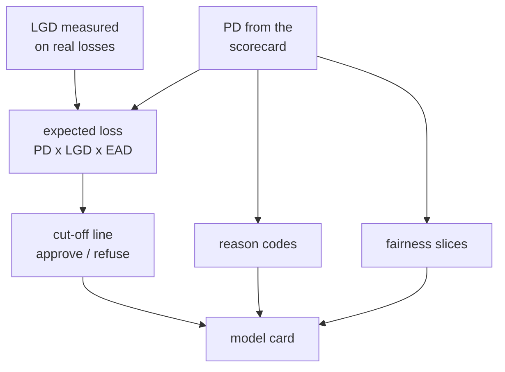

# Money, Fairness, Reason Codes and the Model Card

**Status:** built and measured. The money numbers rest on assumptions that are labelled as assumptions.

## 1. Where it fits (workflow and architecture)

A probability alone does not tell a bank what to do. This part turns the score into money, explanations and checks.

Before: the models (file 04). After: monitoring (file 06). The reason codes reappear in the API (file 08).

Words to know:
- **LGD** (loss given default): the share of the loan the bank loses if the borrower defaults.
- **EAD** (exposure at default): the amount at risk. Here it is the original loan amount (an approximation).
- **Expected loss** = PD x LGD x EAD.
- **Cut-off (the line)**: approve a loan if its PD is below the line.
- **Margin**: what the bank earns on a loan that does not default.
- **Reason code**: a fixed sentence that says why a score is not higher.
- **Model card**: a one-page description of a model, its use and its limits.

## 2. Why we did it

- A bank decides with money, not with Gini. So we asked: what does the line earn?
- Expected loss needs LGD. We measured LGD from real Freddie Mac loss data instead of only assuming it.
- A score must be explainable. A scorecard is additive, so "points lost per feature" is an exact explanation.
- Fairness: the data has no sex, race or age. So no protected group can be tested. Only groups present in the file are compared. This is a report of differences, not a legal certification.
- Rejected: reasons written by an LLM. Sentences are fixed and human-written (`config/reason_codes.yaml`). A feature without a sentence raises an error.

## 3. How we did it

- LGD: `python -m credit.economics.lgd` (`credit/economics/lgd.py`) writes `results/lgd_estimate.json`. Test: `tests/test_lgd.py`.
- Cut-off and sensitivity: `python -m credit.economics.decision_report` writes `results/economics_report.md`. Assumptions: `config/economics.yaml`.
- Reasons: `credit/models/reasons.py`, `config/reason_codes.yaml`, `python -m credit.models.explain_report`.
- Fairness: `python -m credit.models.fairness` writes `results/fairness_report.md`.
- Model card: `scripts/make_model_card.py` writes `docs/model_card.md`.

## 4. How it works

**LGD, measured** (`results/lgd_estimate.json`, after exclusions):

| Vintage | Loss per flagged loan | Share of flagged loans that ended in a loss event | Loss of a loss event |
|---|---|---|---|
| 2008 | 20.1% | 47% | 45.8% |
| 2012 | 4.4% | 27% | 20.9% |
| 2016 | 1.07% | 11% | 10.8% |
| 2019 | 0.37% | 4% | 13.4% |
| 2022 | 0.46% | 7% | 10.7% |

(2019 and 2022 are incomplete: selling a repossessed house takes years.) Our PD counts every flagged loan, and most flagged loans cure. So expected loss must use "loss per flagged loan", not the severity of foreclosures.

**The line.** Base assumptions: margin 2% over 24 months, loss per flagged loan 10% (assumptions, not facts). Textbook line = margin / (margin + loss) = 0.1667. The line chosen on validation by realised profit: approve if PD <= 0.1471, which approves 97.5% of loans. It refuses 29.4% of the defaults and 1.9% of the good loans. Gain over "approve everyone": +0.024% of exposure on validation. Out of time it is slightly negative (-0.008% in 2019, -0.010% in 2022 at the base loss).

**Reason codes.** For a loan: points lost per feature = best band minus the loan's band. Show a reason only if the loss is at least 5 points, at most 4 per loan. Example: golden loan, credit score -45.8, CLTV -35.6, DTI -32.5 (`docs/decision-log.md`, 2026-10-11). `super_conforming` was marked `reportable: false`. An SHAP comparison (SHAP = a way to credit each feature in XGBoost): the scorecard's first reason is in XGBoost's top 3 for 74% of 2,000 validation loans.

**Fairness.** The four-fifths rule on approval flags nothing, but it is uninformative when 97 to 99% are approved. The refusal-rate ratio shows more: on validation Florida refused 9.8% and channel T 16.6%, against 0.8% for retail. Part is risk-driven. In later years the over-prediction is uneven: first-time buyers 1.69 versus repeat buyers 1.35 (2019 + 2022 pooled, `results/fairness_report.md`).

## 5. Useful notes

- The cut-off barely beats "approve everyone" on prime mortgages. The score is more useful for pricing and provisioning (putting money aside) than for refusing.
- Sensitivity: margin 0.5% with loss 20% refuses 28% of loans (gain +0.251% of exposure). Margin 3% with loss 1 to 5% refuses almost nothing. All 16 cells: `results/economics_report.md`.
- A single line chosen on a pool that includes 2008 does not transfer to calm years.
- Expected loss by risk band: ratio 1.02 and 1.04 in bands 6 and 7, over-predicted in the safest bands, slightly under-predicted at the top.
- Margin is illustrative (no margin data in the files). Flagged loans earn no margin. EAD is the original amount.
- The fairness analysis cannot detect discrimination on protected characteristics. State and first-time buyer are likely proxies. In v2, the spread across groups was smaller in only 4 of 6 variables, with no margin (`results/v2_exam.md`).
- The model card says: not for real credit decisions. It lists the known flaws (era proxies, crisis-dominated training, level too high in calm years).
- Deeper reading: `docs/guide/06_money_explainability_fairness.md`, `docs/model_card.md`.

## 6. Never forget (one sentence)

Money numbers use assumptions that are written in a config file, fairness only covers groups in the data, and reasons are fixed sentences, never invented text.

Recall question: why does expected loss use "loss per flagged loan" and not the severity of a foreclosure?

## Answer

Because the PD counts every flagged loan, and most flagged loans cure or are paid off, so only the average loss over all flagged loans matches that PD.
