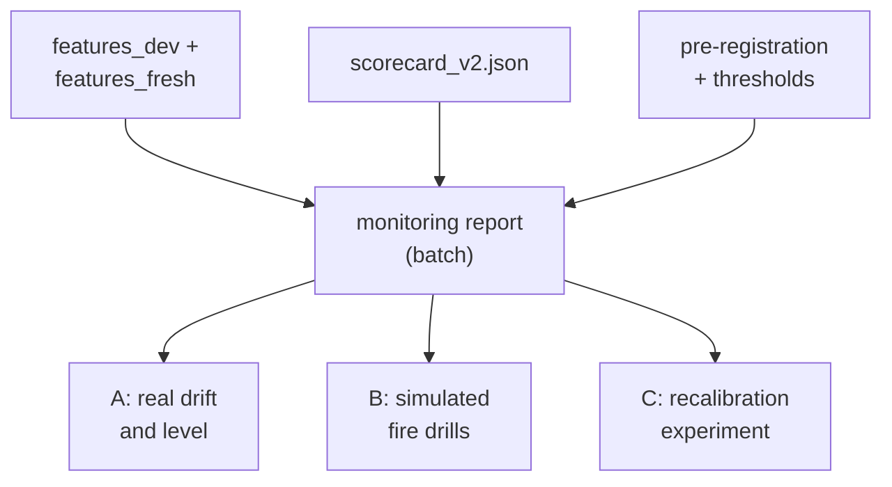

# Monitoring and Drift

**Status:** built and measured, as a batch report. It is not live monitoring. Part of it uses simulated data and says so.

## 1. Where it fits (workflow and architecture)

A model that is already working can slowly go wrong. Monitoring is the dashboard that tells you.

Before: the model file (made in the pipeline, files 04 and 07). After: the pipeline file (07). Monitoring does not run inside the API.

Words to know:
- **Drift**: the world today looks different from the training data.
- **PSI** (population stability index): cut a variable in bands and compare the share of loans in each band, now versus training. 0 = identical. Formula: sum of `(share_now - share_ref) x ln(share_now / share_ref)` (`credit/monitoring/psi.py`).
- **CSI**: the same formula applied to one input of the model. PSI is for the score.
- **Level ratio**: observed default rate divided by mean predicted PD. Careful: other files say "predicted / observed". Here 0.5 means the model predicts twice too many defaults.
- **Fire drill**: damage a batch on purpose to see if the alarm rings. Marked SIMULATED.

## 2. Why we did it

- The model is through-the-cycle: it cannot see the economy. So its level is wrong in calm years (1.4 to 2.6 times too high). The monitors must see this on their own.
- An alarm that was never tested proves nothing. So the alarms were tested with drills.
- Thresholds were fixed on 2026-10-11 before any result existed: `config/monitoring.yaml` (PSI warn 0.10, alert 0.25; level ratio warn outside 0.80 to 1.25, alert outside 0.67 to 1.50). They are assumptions, not facts.
- Rejected: Evidently (a monitoring library). The project uses its own PSI/CSI code. Two subtle shifts are invisible to it (reported).
- Rejected: a fix by history (below).

## 3. How we did it

- Rules first: `docs/monitoring_preregistration.md` and `config/monitoring.yaml`.
- Code second: `credit/monitoring/` (`scoring.py`, `psi.py`, `drift.py`, `simulate.py`, `recalibration.py`, `report.py`).
- Run: `python -m credit.monitoring.report`. It refuses to run unless the pre-registration and thresholds are committed and unmodified. Results: `results/monitoring_report.md` and `.json`, chart `docs/monitoring.png`.
- Tests: `tests/test_monitoring.py`. In Dagster it is the asset `monitoring_report` with a blocking check (file 07).

## 4. How it works

**Part A: real drift and level** (`results/monitoring_report.md`, observed / predicted):

| Vintage | Obs / pred | Flag | Gini | Score PSI |
|---|---|---|---|---|
| 2008 | 1.80 | alert (under-predicted) | 0.659 | 0.049 |
| 2012 | 0.35 | alert | 0.642 | 0.454 (alert) |
| 2014 | 0.38 | alert | 0.599 | 0.042 |
| 2018 | 0.47 | alert | 0.543 | 0.038 |
| 2019 | 0.77 | warn | 0.472 | 0.023 |
| 2023 | 0.71 | warn | 0.595 | 0.091 |

Only the 2008 crisis is under-predicted. All others are over-predicted, because 2008 anchors the level. Lesson: 2012 has a PSI alert (refinance wave: `purpose` CSI 0.311) but Gini 0.642. A drift alarm is not a failure alarm.

**Part B: drills** (batch of 10,000 loans, SIMULATED). The clean control stayed quiet. All 7 expected alerts fired (S1, S3, S4, S5, S6, S7 by CSI, S9 by the level ratio). The score PSI alone caught none of S1 to S7 at alert level (max 0.122). Never monitor only the score. Two subtle drills were missed: S2 (credit score -10) and S8 (defaults x1.25).

**Part C: can history repair the level?** Idea: shift the level by a constant on the log-odds scale so it matches the last known vintage. Arms: A (do nothing), B (last known vintage), C (pooled known vintages). The rule, written first: the mean error must fall at least 20%, at least 5 of 7 targets must improve, and no target may worsen by more than 0.30.
- B: mean error fell 31.2% and 5 of 7 targets improved, but the worst worsening was +0.650 (2012, where the only known year was the 2008 crisis). Rejected by the guard.
- C: worse on average (-28.0%). Rejected on all three.
It helped in stable years (2014: 0.97 to 0.26) and hurt at turning points (2012, 2019), exactly when a correction matters.

## 5. Useful notes

- Predictions: 11 of 13 hit. Misses: A2 (largest score PSI was 2012, not 2008, 2010 or 2023) and C2 (arm C did not improve 2018).
- S4 (10% missing credit scores) is detectable only because the real baseline is 0.026% missing. With a 1% baseline its PSI would be 0.247, just under the alert line. A documented blind spot with a test.
- Exploratory test "without 2008" (`results/exploratory_without_2008.md`, not pre-registered, no decision depends on it): calm years get closer to reality (2018: 0.47 to 0.78), but the crisis is then under-predicted four times (ratio 4.03). The plain average hides this. The through-the-cycle model was kept.
- Future path, not built: a Vasicek "climate dial" (one shared economy factor), a house-price variable, or mixed-effects models (`docs/decision-log.md`, 2026-10-12). With only nine sample years, adding macro variables risks memorising the years.
- Part A on the five development years is in-sample. Out-of-sample years are 2010, 2014, 2018, 2023.
- Not claimed: live monitoring, alerts sent to anyone, or any use of the lake (the monitors read local files).
- Deeper reading: `docs/guide/10_serving_and_monitoring.md`.

## 6. Never forget (one sentence)

Watch every input (CSI), not only the score (PSI), because a drift alarm is not a failure alarm and the score alone missed every drill.

Recall question: why was recalibrating from the last known year rejected even though it cut the average error by 31%?

## Answer

Because it broke the pre-registered guard: it made some years much worse (+0.650 in 2012), and those are the turning points where a correction matters most.
