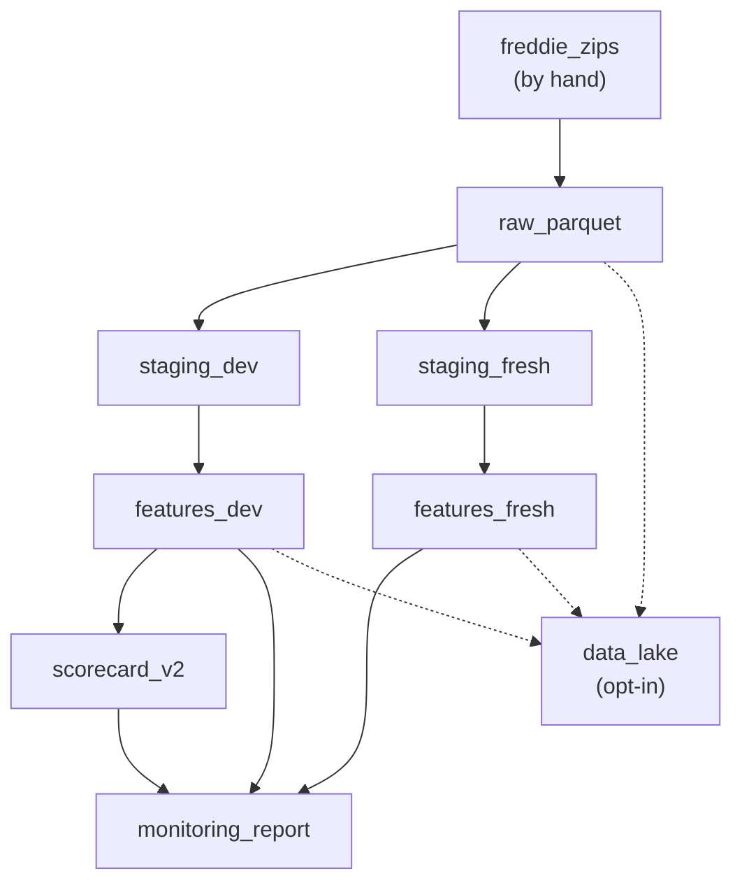

# The Pipeline: Orchestration with Dagster

**Status:** built and measured (reproducibility checked on the real data). It runs on the laptop only.

## 1. Where it fits (workflow and architecture)

This is the kitchen routine. It runs the steps of files 02, 04 and 06 in the right order, with one command.

Before: the model code (files 02 to 06). After: the model file is served (file 08).

Words to know:
- **Orchestration**: a tool that runs steps in the right order and knows what depends on what.
- **Dagster**: the orchestration tool used here. It thinks in "assets" (data products) more than in tasks.
- **Asset**: a thing the pipeline builds, such as a table or the model file.
- **Asset check**: a test attached to an asset. A **blocking** check stops everything that depends on it when it fails.
- **Fingerprint**: a short code (a hash) of the content. If one byte changes, it changes.

## 2. Why we did it

- Without it, you run six commands by hand in the right order, and you may forget one.
- Dagster over Airflow: Airflow says "run X then Y". Dagster says "this table is built from that one". That fits data products with checks (`docs/guide/11_interview_project_qa.md`, question 10).
- Run history on the laptop only (`.dagster_home/`, git-ignored). A server running 24 hours a day was rejected: extra cost and a thing to manage. Dagster stays local (`docs/decision-log.md`, 2026-10-11).
- The pipeline only wraps the code that already existed. It adds order, skipping and checks, no new maths.

## 3. How we did it

Files:
- `pipeline/steps.py`: plain Python functions for each step.
- `pipeline/checks.py`: the file checks.
- `pipeline/freshness.py`: the skip rule.
- `pipeline/definitions.py`: the Dagster assets and checks.
- `pipeline/run.py`: the one-command runner.
- `workspace.yaml`: tells Dagster where the code is (needs `working_directory: .`).
- Tests: `tests/test_pipeline.py`.

Commands (from `CLAUDE.md`):
- Run everything: `.venv/Scripts/python -m pipeline.run` (add `--full` to force a rebuild).
- See the picture: set `DAGSTER_HOME` to `.dagster_home`, run `dagster dev`, open http://127.0.0.1:3000.
- Materialise parts: `python -m dagster asset materialize -m pipeline.definitions --select "raw_parquet*"`. A bare `*` fails on Windows: the shell expands it into file names.

## 4. How it works

**The graph** (`pipeline/definitions.py`): 1 external asset (`freddie_zips`, downloaded by hand) and 8 built assets: `raw_parquet`, `staging_dev`, `staging_fresh`, `features_dev`, `features_fresh`, `data_lake`, `scorecard_v2`, `monitoring_report`. Each built asset has a blocking check. Examples: files present and not empty; staging data checks re-run on the written files; the model file is valid and the golden loan still scores 553.3 +/- 0.2 points; the monitors' own self-test still passes.

**The skip rule.** A step re-runs if an output is missing, or any input (a data file or the code file that defines the step) is newer than the oldest output. It can only err on the safe side: an extra rebuild, never a stale result. A missing input is an error. `--full` (or `PIPELINE_FULL=1`) forces everything.

**Example.** You edit a rule in `credit/freddie/features.py`. Next `pipeline.run` rebuilds `features_dev`, `scorecard_v2` and the report, and reuses the raw and staging steps.

**The data lake step** (`data_lake`) only runs when `CREDIT_LAKE=1`. By default the pipeline stays offline. A test forbids it from importing AWS libraries.

**Safeguards** (tested):
- The model asset depends on `features_dev` only. The fresh years are not among its ancestors.
- Staging reports of the fresh years show only structural counts, never default counts.
- The exam scripts (`final_exam`, `v2_exam`) are deliberately not in the pipeline.

## 5. Useful notes

- Reproducibility, measured: a full rebuild from the 9 zips took 5 min 1 s, with the 6 assets that existed then all rebuilt and their 6 checks passed. Fingerprints of the development table (229,419 rows), the fresh table (177,081 rows) and the model id `b3069001d62e` were identical before and after (`docs/decision-log.md`, 2026-10-11). A second run with nothing changed reused every step in about 50 s.
- Problems found: (a) `stage_year` had `raw_dir` as a default argument frozen at import time, so a test that redirected the path silently read the real 2016 file. (b) An empty staged folder could be "reused". (c) The Dagster CLI on Windows expands `*`. (d) `workspace.yaml` needs `working_directory: .`. (e) Dagster starts one process per step by default (a no-op run took 255 s). The in-process executor brings it to 63 s.
- The model step once rebuilt for nothing after `monitoring.yaml` was added, because it watched every file in `config/`. It now watches only `assumptions.yaml` and `reason_codes.yaml`.
- Rebuilding the model rewrites `exported_on` in the model file (metadata only). The model id does not change.
- Not claimed: scheduling, a server, retraining on new data (the data is a static snapshot).
- Deeper reading: `docs/guide/10_serving_and_monitoring.md`, section 3.

## 6. Never forget (one sentence)

One command runs the kitchen in order, skips what is up to date, and a failed check stops everything that depends on it.

Recall question: what does a "blocking" check do?

## Answer

If the check fails, the assets that depend on it do not run, so nothing is built on bad data.
