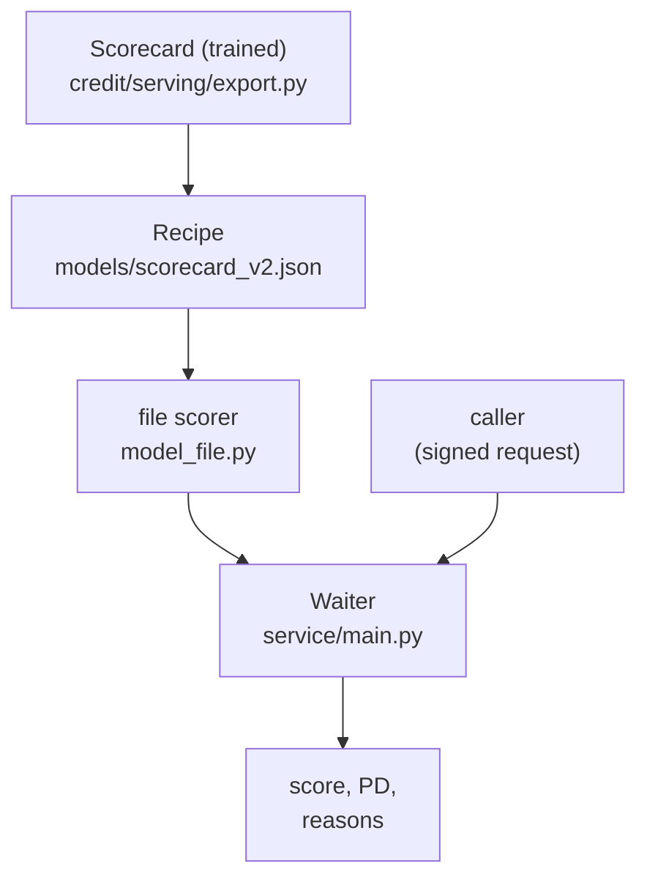

# Serving: the Model File and the API

**Status:** built and measured (tests, golden loan, live smoke test).

## 1. Where it fits (workflow and architecture)

The kitchen made the recipe. Now we give it to the waiter.



Before: pipeline builds the model file (file 07). After: the container packs the waiter and the recipe (file 09).

Words to know:
- **API**: a program that waits for questions and answers them over the web.
- **FastAPI**: a Python library to write an API. Here it is the waiter.
- **JSON**: a plain-text format for data, like `{"credit_score": 700}`.
- **Pydantic**: a library that checks the shape and type of incoming data.
- **Standard library**: the tools that come with Python. No extra install.
- **Golden loan**: one made-up loan whose score is known. A test fails if the model ever changes by accident.
- **uvicorn**: the small web server that runs the FastAPI code.
- **422**: the web answer "I understood the request, but the content is not valid".

## 2. Why we did it

- The scorecard is just a table of points. So it can be one small file (about 7 KB, 7,260 bytes). Scoring is addition plus one formula. It needs no scikit-learn, no numpy, no training data.
- Small and standard-library-only means a small image and a fast start in Lambda (file 09).
- The model file is baked into the container image. The image is the version: nothing can drift between code and model. Loading it from S3 at start-up was rejected (`docs/decision-log.md`, 2026-10-11).
- The API takes the loan facts directly. The earlier plan of keeping 5,000 applicants inside the API was dropped.
- The API never decides approve or refuse. That choice stays outside, because money assumptions are not facts.

## 3. How we did it

- Export (training side): `credit/serving/export.py`. Run through `scripts/export_v2_scorecard.py` and the pipeline asset `scorecard_v2`.
- The scorer: `credit/serving/model_file.py` (standard library only; a test parses its imports). Tests: `tests/test_model_file.py`.
- The API: `service/schemas.py` (input and output shapes) and `service/main.py` (`create_app`). Tests: `tests/test_api.py`.
- Run on the laptop: `.venv/Scripts/python -m uvicorn service.main:create_app --factory --reload`, then open http://127.0.0.1:8000/docs.
- Libraries are pinned in `requirements-service.txt` (14 libraries).

## 4. How it works

**The file.** `models/scorecard_v2.json` has: scaling, 9 features with 50 bands and their points, the best points per feature, fixed reason sentences, `known_limits`, `training_ranges`, and a `model_id` (`b3069001d62e`). The id is a hash of what the model computes. Changing one point changes the id.

**Start-up.** The API loads and validates the file. If it is missing or damaged, the service refuses to start.

**Four endpoints:**
- `GET /health`: alive, model id and version.
- `GET /model-info`: scale, inputs, training ranges, known limits.
- `POST /score`: points and probability of default.
- `POST /explain`: the same plus the top reasons (`top_k` 1 to 9, default 4).

**Strict input.** Unknown fields are rejected. No type guessing: `"700"` (text) is refused. Numbers must be in the valid ranges of the data dictionary (for example credit score 300 to 850). Every field is required but may be `null` (unknown): the model has a band for missing values. The caller sends `interest_rate` and `reference_rate`. The API computes `rate_spread` itself, so the caller must supply a reliable reference rate.

**Example** (the golden loan, `scripts/smoke_test_api.py`):

```json
{"credit_score": 700, "dti": 44.0, "ltv": 85.0, "cltv": 85.0,
 "interest_rate": 4.55, "reference_rate": 4.0, "number_of_borrowers": 1,
 "mi_pct": 25.0, "term_months": 360, "purpose": "P"}
```

Answer: score 553.3 points, probability of default 9.17%. Top reasons: credit score, CLTV, DTI. The answer has no approve/refuse field.

**Loans outside the training range** are scored but listed in `outside_training_range`. Every answer carries a caution: the probability is through-the-cycle and has been 1.4 to 2.6 times the real rate in calm years.

**Bad input** gives a clean 422 that names the field and the problem. It never echoes the value back.

## 5. Useful notes

- Verified equal: the file scorer equals the scikit-learn scorecard (scores within 1e-9) on made-up data and on 20,000 real loans (`docs/decision-log.md`, 2026-10-11).
- A test found a bug: the non-standard JSON value `Infinity` made the error response itself crash (a 500 instead of a refusal). A custom handler now reports field and problem without echoing the value. Guard: `test_bad_values_rejected[dti-inf]`.
- The API stores nothing and logs no loan data.
- The golden loan must score 553.3 (+/- 0.2) and 9.17% (+/- 0.06 percentage points). If it fails, the model changed. That must be a deliberate, versioned decision.
- `rate_spread` needs a reliable reference rate from the caller. A single loan has no "same quarter" peers.
- Not claimed: scoring from the lake (the API does not read the lake), authentication inside the app (the lock is at the Function URL, file 09), a decision engine.
- Deeper reading: `docs/guide/10_serving_and_monitoring.md`.

## 6. Never forget (one sentence)

The recipe is a 7 KB JSON of points, the waiter checks every incoming value strictly, and neither of them ever decides to approve or refuse.

Recall question: why can the scorer run with only the Python standard library?

## Answer

Because the model is a table of band edges and points, so scoring is a lookup, a sum and one formula, with no machine-learning library and no training data.
