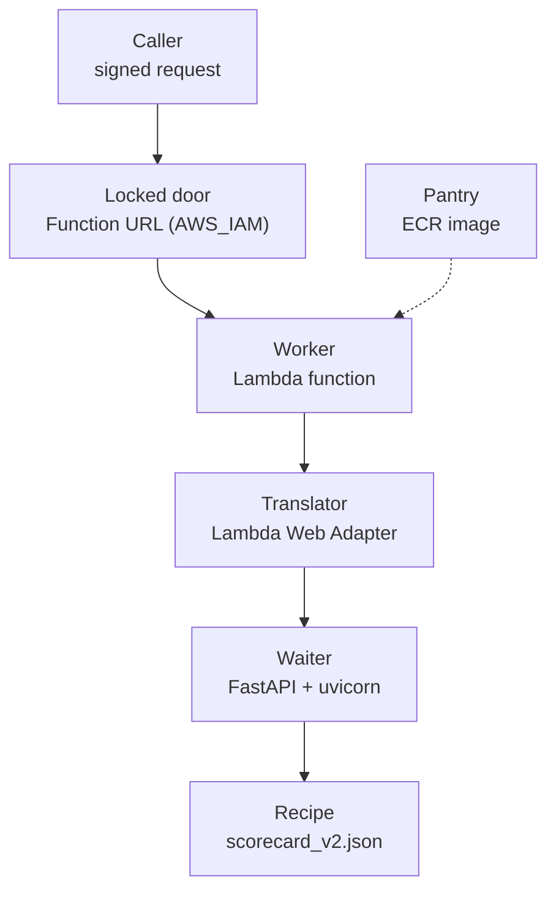

# The Container and AWS Lambda

**Status:** built and measured on the live function (2026-10-13).

## 1. Where it fits (workflow and architecture)

The waiter and the recipe are packed in a lunchbox. A sleeping worker opens the lunchbox when someone knocks.

Before: the waiter and recipe (file 08). After: the robot that swaps the lunchbox (file 10).

Words to know:
- **Docker image**: a sealed package with your code, its libraries and the operating-system parts it needs. Here, the lunchbox.
- **Container**: an image that is running.
- **AWS Lambda**: runs your code only when a request comes, then goes back to sleep. No server to manage. The sleeping worker.
- **Cold start**: the first request after a quiet time. A new container must be prepared. The worker is waking up.
- **ECR** (Elastic Container Registry): storage for images. The pantry.
- **Function URL**: a web address that calls one Lambda function directly.
- **`AWS_IAM`**: the lock mode of a Function URL. Every request must be signed.
- **SigV4** (Signature Version 4): AWS's way to sign a request with your temporary key. Without a valid signature, the answer is 403 Forbidden.
- **IAM role**: a uniform. Its **trust rule** is the guest list (who may wear it). Its **permissions** say what the uniform may do.
- **TLS handshake**: the secure-connection setup that happens before a request is sent.
- **Manifest**: the list that describes the layers of an image. **Image tag**: a name on an image, such as a git commit.
- **x86_64 / amd64**: the type of processor the image is built for.

## 2. Why we did it

- Lambda scales to zero: no compute is billed while idle. Billed compute in the measurement window was 1.36 GB-seconds, against a free tier of 400,000 GB-seconds a month (`results/lambda_latency.md`). The first real bill lines were not read in the repo.
- A container image lets the same box run on the laptop, in CI and in Lambda (`Dockerfile` header).
- The Lambda Web Adapter lets an ordinary web app run in Lambda with no code change. It does nothing outside Lambda.
- Alternatives named in the log and not used: ECS Fargate, App Runner (fall-backs if Lambda failed).
- A public URL was rejected for now: it would need a spending guard. There is no public demo on purpose.
- Reserved concurrency (a spending cap) cannot be used: the account quota is 10, and AWS only lets you reserve the limit minus 100. Protection instead: the quota itself, the locked URL, small memory and short timeout, 14-day log retention, keep-last-3 images, two budget alerts (`docs/decision-log.md`, 2026-10-12).

## 3. How we did it

Files: `Dockerfile`, `.dockerignore`, `requirements-service.txt`, `scripts/expected_image_files.txt`, `tests/test_container.py`, `scripts/smoke_test_api.py`, `scripts/measure_latency.py`, and `infra/`.

In order (you run the scripts, never the assistant; each has `-DryRun`; each is safe to run twice):
1. Local build: `docker build -t scoring-api:local .`, `docker run --rm -p 8080:8080 scoring-api:local`, then `python scripts/smoke_test_api.py --url http://127.0.0.1:8080 --wait 60`.
2. `aws sso login --profile credit-admin`.
3. `infra/01_create_ecr.ps1`: private repository `credit-scoring-api`, immutable tags, encryption, keep-last-3 rule.
4. `infra/02_push_image.ps1`: build for one architecture (`--platform linux/amd64 --provenance=false --sbom=false`), smoke-test, push tagged with the git commit, check the stored manifest.
5. `infra/03_create_lambda.ps1`: role, log group, function, Function URL.
6. `scripts/measure_latency.py`: measures the live function.
7. Undo everything: `infra/99_teardown.ps1` (asks you to type each name).

## 4. How it works

**The image** (`Dockerfile`): base `python:3.13-slim-bookworm`. The adapter (v1.1.0) is copied in, pinned by version and by content fingerprint. Only the libraries of `requirements-service.txt` are installed (no pandas, no scikit-learn). Only 8 files are copied: `credit/__init__.py`, `credit/serving/__init__.py`, `credit/serving/model_file.py`, 3 files in `service/`, `models/scorecard_v2.json`, `requirements-service.txt`. `.dockerignore` is an allow-list, so data, results, tests and `.git` never reach Docker. It runs as a non-root user (uid 10001). Stored in ECR: a single image of 51.2 MB.

**Why one architecture and no attestation.** Recent Docker adds extra metadata (an attestation manifest) and can build multi-architecture images. Lambda rejects both. Hence the flags in step 4.

**The Lambda function.** 512 MB, 10 s timeout, x86_64, package type Image. Its role `credit-scoring-api-lambda` can be assumed only by Lambda (trust rule). Its one permission: `logs:CreateLogStream` and `logs:PutLogEvents` on its own log group, nothing else. The managed `AWSLambdaBasicExecutionRole` was not used because it allows logs everywhere.

**The locked door.** The Function URL uses `AWS_IAM`. An anonymous visitor gets 403. A signed request carries a signature computed from the request and the key, with service `lambda` and region `eu-north-1`. Tests check the scope, that the signature changes when the body changes, and that requests stay unsigned by default.

**One request.** Caller signs and knocks. The worker wakes (cold start) or is already awake (warm). The translator forwards to the waiter on port 8080, after it sees `/health` answer. The waiter scores and replies.

**Updating** the function = swapping the lunchbox: `aws lambda update-function-code --image-uri ...` (done by the robot, file 10).

## 5. Useful notes

Measured on the live function, 71 invocations (`results/lambda_latency.md`, `results/lambda_latency.json`):

| What | Value |
|---|---|
| Warm request (server side) | 2.7 ms median, p95 3.0 ms, max 3.3 ms (n=69) |
| Cold start, init duration | 1,188 ms and 1,315 ms (n=2) |
| Memory used | 78 MB of 512 MB |
| Round trip from my laptop to Stockholm (30 signed `POST /score`) | median 681 ms, p95 1,505 ms |

- The 2.7 ms and 0.68 s do not conflict. The first is compute. The second adds the internet trip, a new TLS handshake per call, and signing.
- The cold start rests on only 2 observations. Quote it as "about 1.2 to 1.3 s". Nothing supports claims about throughput or load.
- For a container image, the cold-start init is billed. Max billed duration was 1,319 ms.
- Surprises: Lambda added a repository policy on ECR by itself (wider than the minimum: it includes `SetRepositoryPolicy`). Possible hardening, not done. The smoke test once crashed on a TLS handshake timeout from a slow network; it now retries network errors up to 3 times and never retries a real server answer.
- Two PowerShell traps were fixed before the first run: stderr text becomes an exception in Windows PowerShell 5.1, and a function returns everything it prints.
- Since October 2025, a new `AWS_IAM` Function URL needs both `lambda:InvokeFunctionUrl` and `lambda:InvokeFunction` for the caller (file 10).
- The Free plan ends in about six months. The API will then disappear (`README.md`).
- Deeper reading: `infra/README.md`, `docs/guide/11_interview_project_qa.md`, section D.

## 6. Never forget (one sentence)

The lunchbox (image) lives in the pantry (ECR), the sleeping worker (Lambda) opens it behind a locked signed door, and it costs about 3 ms of compute per warm call.

Recall question: what is a cold start and what did we measure for it?

## Answer

A cold start is the first call after a quiet time, when a new container must be prepared; we measured an init of about 1.2 to 1.3 s on 2 observations, against 2.7 ms for a warm request.
