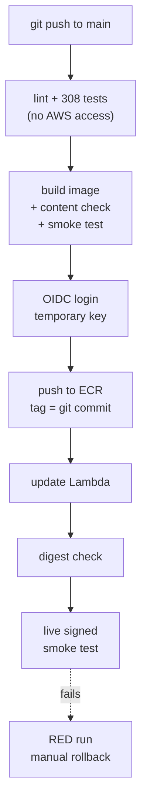

# CI and Automatic Deploy with OIDC

**Status:** built and measured (CI green; Deploy #3 green end to end). Automatic rollback is planned, not built.

## 1. Where it fits (workflow and architecture)

The robot carries lunchboxes. It tests first with no AWS access. Only then does it ask AWS for a key.

Before: the lunchbox and the worker (file 09). After: the data lake (file 11).

Words to know:
- **CI** (continuous integration): a robot that tests the code on every push.
- **GitHub Actions**: GitHub's robot. Workflows are files in `.github/workflows/`.
- **OIDC** (OpenID Connect): GitHub signs an "ID card" for each run. AWS checks it. No password is stored anywhere.
- **Subject (`sub`)**: the line on the ID card that says which repository and branch the run belongs to.
- **Digest**: the fingerprint (hash) of an image. A tag can move. A digest cannot.
- **Smoke test**: a quick test that the live thing answers and gives the expected result.
- **Role trust rule** = the guest list. **Role permissions** = what the uniform may do.
- **Image tag**: a name on an image. Here it is the 7-character git commit. **Immutable** means a tag cannot be overwritten.
- **429**: the web answer "too many requests, slow down".

## 2. Why we did it

- Stored AWS keys in GitHub can leak. With OIDC there is no secret at all. The only setting is a non-secret variable `AWS_DEPLOY_ROLE_ARN` (an address).
- Testing before the key means a broken build never touches AWS.
- A "live" smoke test proves the deployed function really works.
- Alternatives named in the log: storing keys (rejected), reusing `ci.yml` as a reusable workflow (rejected: it shares CI's concurrency group and the two runs would cancel each other; instead the test steps are duplicated and a test checks the key commands are identical).
- Automatic rollback was not built: it would be a code path that has never been exercised (`docs/decision-log.md`, 2026-10-16).

## 3. How we did it

- `.github/workflows/ci.yml`: on every push and pull request. Permissions `contents: read`, no secrets, no data, 20-minute timeout, newer pushes cancel older runs.
- `.github/workflows/deploy.yml`: on push to `main` (and manual). Skipped until the variable exists. Runner pinned to `ubuntu-24.04`. Actions pinned to commit hashes. Never cancelled half-way.
- `infra/05_create_github_deploy.ps1` (you run it, `-DryRun` first): creates the trust entry and the role `credit-risk-github-deploy`. Templates: `infra/github_oidc_trust_policy.template.json`, `infra/github_deploy_policy.template.json`.
- Store the role address: `gh variable set AWS_DEPLOY_ROLE_ARN --repo <owner>/credit-risk-platform --body <role address>`.
- Tests: `tests/test_deploy.py`, `tests/test_infra_scripts.py`, `tests/test_container.py`.

## 4. How it works

**CI steps:** checkout, Python 3.13, pinned libraries, `ruff check .`, `pytest -q`, build the image (up to 4 tries), compare the file list inside the image to `scripts/expected_image_files.txt`, run the container and `scripts/smoke_test_api.py`.

**Deploy steps:** the same, then:
1. Temporary key through OIDC (about an hour).
2. Push the image tagged with the 7-character git commit. Tags are immutable, so an existing tag is reused. Refuse anything but a single image manifest.
3. `update-function-code`, then wait until the function is Active and the update Successful.
4. Check that `Code.ResolvedImageUri` contains the pushed digest: the function runs exactly that image.
5. Live smoke test of the locked URL, signed with the temporary key.

**The guest list (trust rule).** One `StringEquals` condition, no wildcard: audience `sts.amazonaws.com` and subject `repo:<owner>@<owner id>/<repo>@<repo id>:ref:refs/heads/main`. Only this repository, only `main`. The numbers are permanent ids, so a deleted-and-recreated repository with the same name could not take the role.

**What the uniform may do** (permissions): get a temporary ECR password; push and read images of one repository; update and read one function; call that function's locked URL (`InvokeFunctionUrl` with `AWS_IAM`, and `InvokeFunction` only when called via the URL). It was not given `ecr:SetRepositoryPolicy`. Not given: S3, IAM, billing, other functions, delete. AWS's policy simulator proves 3 allowed and 7 forbidden actions, and the script stops on any surprise.

**The first refused login.** Deploy #1 stopped at the OIDC step: `Not authorized to perform sts:AssumeRoleWithWebIdentity`. The role was written with `repo:<owner>/<repo>:ref:refs/heads/main`. Deploy #2 had a failure-only step that prints the non-secret claims. GitHub's real subject was `repo:<owner>@<owner id>/<repo>@<repo id>:ref:refs/heads/main`. For repositories created after 2026-07-15, GitHub writes the numeric ids into the subject. AWS compares text exactly, so it said no. Fix: the trust template now uses the numeric format and the script re-applied it. Deploy #3 was green.

**Rollback today (manual):** list the tags in ECR, then point the function at an older one. Commands in `infra/README.md` and printed by the failed run: `aws ecr describe-images ...` then `aws lambda update-function-code --function-name credit-scoring-api --image-uri <registry>/credit-scoring-api:<older tag> ...`. The last 3 images are kept.

## 5. Useful notes

Deploy #3 timings (`docs/decision-log.md`, 2026-10-16): total 162 s; pytest 30 s; image build 13 s; temporary key 2 s; push 19 s; Lambda update 15 s; live check 8 s.

- **The 429 flake.** CI #24 and #27 failed at the image build with `429 Too Many Requests` while fetching the Lambda adapter from a public registry. Public registries limit anonymous downloads per IP, and GitHub machines share addresses. The same code passed elsewhere. Fixes: the adapter is pinned by version AND digest in the `Dockerfile`, and both workflows retry the build up to 4 times (waits 30, 60, 90 s). Limit: a retry from the same machine may hit the same limit. Longer fix, not done: authenticated pulls or a copy in our own ECR.
- Lesson: write a trust rule from the claim that is really sent, not from a documentation example.
- Every push to `main` deploys, even docs-only pushes. A `paths-ignore` rule could skip them. Harmless: tag = commit, last 3 images kept.
- GitHub warns that two actions still run on Node 20. A warning for now.
- Not claimed: automatic rollback, or that CI never fails.
- The history was rewritten on 2026-10-16 to remove a commit trailer, so older image tags are now only names (file 13).
- Deeper reading: `infra/README.md`, `docs/guide/11_interview_project_qa.md`, section D.

## 6. Never forget (one sentence)

Test first with no AWS access, then show GitHub's signed ID card to get a one-hour key, and the guest list must match the ID card letter for letter.

Recall question: why was the first OIDC login refused?

## Answer

The role's trust rule expected `repo:<owner>/<repo>:...`, but GitHub, for repositories created after 2026-07-15, sends the subject with the numeric owner and repository ids, and AWS compares the text exactly.
