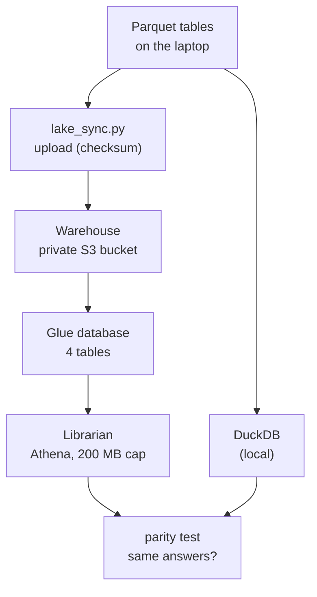

# The Data Lake: S3 and Athena

**Status:** built and measured (parity test 6 of 6, scan cap seen working, run 2026-10-16). Nothing else in the platform reads from it.

## 1. Where it fits (workflow and architecture)

The warehouse stores the tables. The librarian answers questions about them. The API does not use either.

Before: the pipeline makes the Parquet tables (files 02 and 07). After: nothing. It is a side branch.

Words to know:
- **S3** (Simple Storage Service): AWS file storage. A **bucket** is a top-level folder.
- **Data lake**: files (here Parquet) kept in a bucket, read directly by query tools.
- **Glue Data Catalog**: AWS's list of tables, with their columns and where the files are.
- **Athena**: runs SQL on files in S3. You pay for the data it scans. No server. The librarian.
- **Workgroup**: a settings bundle for Athena queries. Here it carries the scan cap.
- **Parquet**: column-based table file. Athena can read only the columns a query needs.
- **Checksum**: a hash of a file. If the file changes, the checksum changes.
- **Parity test**: run the same SQL in two engines and compare the answers.
- **Versioning**: S3 keeps old versions of a file when it is overwritten. **Encryption (SSE-S3)**: files are stored scrambled and unscrambled by AWS for you.
- **Lifecycle (cleanup) rule**: an automatic deletion rule, for example "delete after 7 days".

## 2. Why we did it

- Honest reason (`docs/decision-log.md`, 2026-10-11): Athena is not needed at this size. The 24.7 million monthly rows run in seconds in DuckDB. It was kept for the story, on one condition: never claim it is necessary.
- Its real value is the parity test and a safe pattern: a private bucket, a scan cap, scripts with dry run and teardown.
- Alternatives: keep everything local (what the pipeline does by default); BigQuery was the Google Cloud plan, dropped with GCP.
- The owner's reading is that Freddie Mac terms allow private cloud storage. The terms were read through search summaries. The owner must read and keep the terms they accepted (`docs/decision-log.md`, 2026-10-08). This is not legal advice.

## 3. How we did it

- `infra/04_create_lake.ps1` (you run it; `-DryRun` first; `-ScanLimitMb`, default 200, minimum 10): bucket, Glue database `credit_lake`, Athena workgroup `credit-risk`. Templates: `infra/lake_bucket_policy.template.json`, `infra/lake_lifecycle.json`.
- `scripts/lake_sync.py`, after `aws sso login --profile credit-admin`:
  1. `upload --dry-run`, then `upload` (sends only changed files)
  2. `tables` (creates the 4 tables)
  3. `parity` (writes `results/lake_parity.md` and `.json`)
  4. `cap-demo` (one query that must be cancelled)
- Code: `credit/cloud/lake.py`. Tests: `tests/test_lake.py`.
- Optional in Dagster: the asset `data_lake`, only with `CREDIT_LAKE=1` (file 07).

## 4. How it works

**The bucket** is named `credit-risk-lake-<account>` (the number is computed at run time and never written to a file). It has all four public-access blocks on, encryption (SSE-S3, AES256), versioning, a policy that allows HTTPS only, and 3 cleanup rules: Athena results expire after 7 days, abandoned partial uploads after 1 day, overwritten versions after 30 days.

**Upload.** 4 tables, 20 files, 261.7 MB: `raw_orig` (9 files), `raw_perf` (9), `features_dev` (1), `features_fresh` (1). The script computes a SHA-256 for each file and skips it when the stored checksum matches. After upload it verifies size and checksum. A second dry run said `0 to upload, 20 unchanged`.

**Tables.** `CREATE EXTERNAL TABLE` is built from each Parquet file's own schema, so the table and the file cannot disagree.

**Parity.** Six queries run on DuckDB and on Athena. Counts and sums must be identical. Floats allow 1e-9 relative or 1e-6 absolute difference. Result: 6 of 6 identical (`results/lake_parity.md`).

| Query | Athena scanned | Engine time |
|---|---|---|
| `dev_split_counts` | 0.04 MB | 491 ms |
| `dev_vintage_sums` | 0.66 MB | 528 ms |
| `fresh_structure` | 0.85 MB | 762 ms |
| `raw_orig_loans` | 1.57 MB | 681 ms |
| `raw_perf_rows` | 0.00 MB | 644 ms |
| `raw_perf_loans` | 2.69 MB | 1418 ms |

Total scanned: about 6 MB.

**Example of what Parquet buys.** `raw_perf_rows` (a row count) scanned 0.00 MB: Athena read it from the file footers. `raw_perf_loans` scanned 2.69 MB: it read one column out of 35.

**The cap.** The workgroup cancels any query that would scan more than 209,715,200 bytes (200 MB), and the setting is enforced. `cap-demo` ran `SELECT * FROM raw_perf ORDER BY current_upb` on the 250 MB table. Answer: `CANCELLED: Bytes scanned limit was exceeded`. The setting was read back first, then the behaviour was observed.

## 5. Useful notes

- 200 MB, not 1 GB: the largest table is about 250 MB, so the cap is visible, and no parity query needs more than a few MB.
- AWS bills cancelled queries (documentation). At most about 200 MB scanned here. Price: about 5 USD per TB, to confirm for `eu-north-1` in the console. The whole parity test costs a tiny fraction of a cent (`docs/decision-log.md`, 2026-10-16).
- The fresh vintages contain exam labels. The parity queries on them read structure only, and a test forbids label words in them.
- The CLI printed `TransitionDefaultMinimumObjectSize: all_storage_classes_128K` when the cleanup rules were applied. Harmless information.
- Allowed claim: "Parquet tables in a private S3 lake queried with Athena, with a parity test and a per-query scan cap."
- Not claimed: that the API or the monitoring reads from the lake (they do not), that upload is part of the automatic deploy (it is a script), or that Athena was required.
- The bucket and its versions are removed by `infra/99_teardown.ps1` (each step needs you to type the name).
- Deeper reading: `README.md`, section "What runs on AWS".

## 6. Never forget (one sentence)

The lake is a private warehouse that Athena can read for a capped price, and its only proof of use is that the cloud gave 6 of 6 identical answers to the laptop.

Recall question: what does the 200 MB workgroup limit do?

## Answer

It cancels any single Athena query that would scan more than 200 MB, which we saw happen when a `SELECT *` on the 250 MB monthly table was cancelled.
