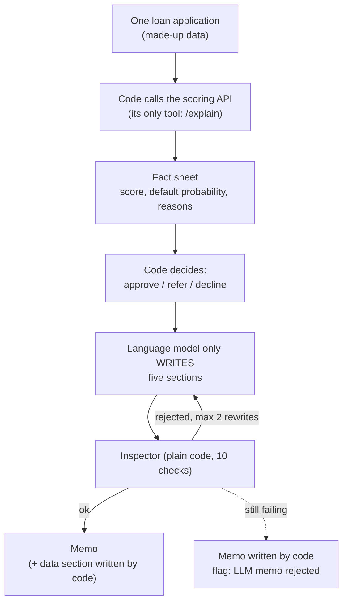

# The LLM Memo Agent (built, measured on a small free model)

**Status:** built and tested (`agent/`, command line only, not deployed on AWS). Measured with one small free model, in French, on made-up loans. Numbers are from `results/agent_eval_*.md`.

## 1. Where it fits (workflow and architecture)

The agent sits after the live API. It asks the API about one loan, then writes a short memo for a human analyst. Code stays in control of every number and of the decision.

Analogy used everywhere in these notes: **chef = code** (decides, cooks the numbers), **writer = language model** (only words the memo), **inspector = validator** (code that checks), **backup printer = memo written by code**.

Words to know:
- **Language model (LLM):** a program that writes fluent text. It can also silently change a number.
- **Credit memo:** a short note explaining one loan to a human analyst.
- **Fact sheet:** the numbers, reasons and decision. The only thing the writer may use. Each number exists in two forms: plain (to check) and display (how it must be written).
- **Inspector (validator):** plain code that checks the memo against the fact sheet.
- **Tool calling:** the agent asks code to run a function. Here there is one function, a POST to `/explain`.
- **Read-only:** it can look, it cannot change anything.
- **Held-out set:** loans never looked at while improving the instructions. Only these give an honest number.

## 2. Why we did it

- A language model writes fluent text but can change a number without warning. So numbers and decision come from code, and a checker proves the text matches. A small free model is enough: it only has to write.
- Rule from `CLAUDE.md`: "The memo agent is read-only; its recommendation is computed by code; a validator checks every number."

| Alternative | Why not |
|---|---|
| Let the model decide approve / refer / decline | Can be fluent and wrong; the decision must be reproducible and testable. |
| Several tools | More freedom, more ways to be wrong, more to test. One tool is enough. |
| An agent framework | Plain tool calling is small and readable; a framework hides the loop that must be defended. |
| No checker | A changed number would reach the reader. |

## 3. How we did it (the files)

| File | Job |
|---|---|
| `config/memo_policy.yaml` | The two policy lines (approve below 2% default probability, decline above 5%; an **assumption**, not a lending policy), limits (60 to 260 words, 2 rewrites), French and English texts, forbidden words. |
| `agent/policy.py`, `agent/facts.py` | Code decides; builds the fact sheet. |
| `agent/template.py` | The memo written by code (backup, and the data section of every memo). |
| `agent/prompt.py` | Instructions for the writer, with a word budget computed by the inspector's own counter. |
| `agent/validator.py` | The inspector: 10 checks (numbers with their sign, spelled-out numbers, decision word and conflicting words, fixed warnings, risk stated, forbidden promises, six headings, no empty section, length, data section unchanged). |
| `agent/writer.py`, `agent/doubles.py` | Real writer (any OpenAI-compatible service, key from an environment variable) and pretend writers for tests. |
| `agent/memo.py` | The loop: write, inspect, rewrite at most twice, else backup. |
| `agent/api_client.py`, `agent/run.py` | The only tool and the command line. |
| `agent/evaluate.py`, `agent/models.py`, `scripts/make_agent_holdout.py` | The exams, the intervals, the model probe, the random loans. |

## 4. How it works, and what was measured

1. Code calls `/explain`, gets score, default probability and reasons.
2. Code computes the recommendation from the two policy lines.
3. The writer receives only the display forms of the numbers and writes five sections.
4. The inspector checks. Rejected: the writer gets the list of complaints and rewrites (max 2). Still failing: the memo written by code is used and flagged.
5. The section with the loan's own numbers is always written by code.

**The inspector catches a spelled number** such as "deux": a list of spelled numbers per language is searched as whole words. It checks that a number **exists on the sheet**, not what it **means** (known limit; the data section written by code covers the main case).

| Exam | Result |
|---|---|
| Pretend writers, 10 kinds of mistake on 15 loans | **150 of 150** damaged memos rejected |
| Llama 3.2 11B, French, tuning loans (used to improve instructions) | 14 of 15 first try (a tuning score, not a result) |
| Same model, 20 random held-out loans (version 2) | 12 of 20 first try: overfitting to the tuning loans |
| **Same model, 20 other fresh loans (version 3)** | **18 first try, 1 after a rewrite, 1 backup; 0 of 23 tries rejected for safety; median 19 s per loan** |

With 20 loans the 95% interval on "first try" is 70% to 97% (Wilson). The v2 to v3 improvement is suggested, not proven: different loans.

## 5. Useful notes

- **Free service behaviour:** a model listed is not always callable (404 "function not found for account"); reasoning models spend the token budget thinking and can return empty text (`finish_reason length`); calls are slow because the service is shared and queues.
- **Bugs found by held-out loans, in my own code:** negative numbers ignored; the decision word "refer" matched inside "Reference". Both fixed with tests.
- **Weakness:** a rewrite barely helps a model this small; it tends to copy its memo back.
- **Not claimed:** other models, English, production use, deployment on AWS, any cost.
- The score is through-the-cycle: in calm years the default probability has been 1.4 to 2.6 times the real rate; every memo carries that caution.
- Deeper reading: `docs/decision-log.md` (the memo agent entries), `docs/guide/11_interview_project_qa.md` (Q39 to Q51).

## 6. Never forget (one sentence)

The model only writes; code computes every number and the decision; the inspector proves the text matches; the memo written by code is the fallback.

Recall question: the inspector checks that a number exists on the sheet. What can it NOT check?

## Answer

Which fact the number belongs to in the free text (it checks membership, not position). That is why the section with the loan's own numbers is written by code.
