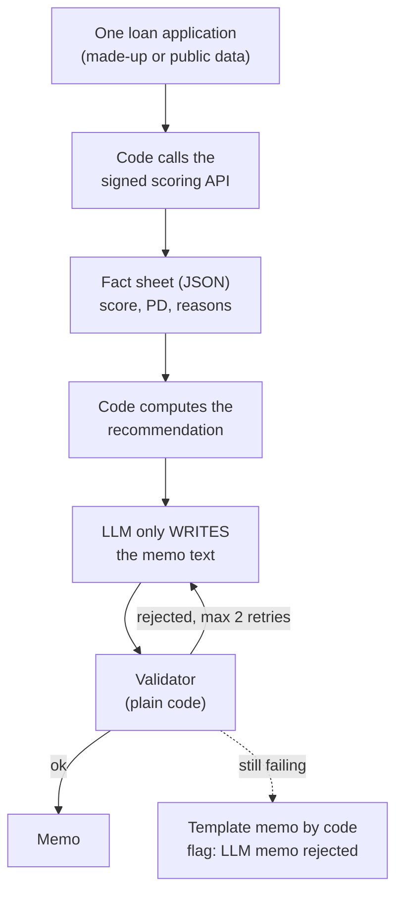

# The LLM Memo Agent (PLANNED, NOT BUILT)

**Status:** planned, NOT BUILT. There is no `agent/` folder in the repo today. There are no results, no pass rates, no latency, no cost. This file describes a design that was decided with the owner. It is not yet written in `docs/decision-log.md`.

## 1. Where it fits (workflow and architecture)

The memo agent would sit after the live API. It would call the API, then write a short memo. Code stays in control of every number and of the decision.

Before: the live locked API (files 08 and 09). After: nothing.

Words to know:
- **LLM** (large language model): a program that writes fluent text. It can also silently change a number.
- **Credit memo**: a short note that explains one loan application to a human analyst.
- **Fact sheet**: a JSON with the numbers, reasons and recommendation. The only thing the LLM may use.
- **Validator**: plain code that checks the memo against the fact sheet.
- **Tool calling**: the LLM asks code to run a function. Here there is only one function.
- **Read-only**: it can look but cannot change anything.
- **Fallback**: the plan B output when the main one fails.

## 2. Why we did it

The idea (why this design):
- LLMs write fluent text but can silently change numbers. So the numbers and the decision come from code. A checker proves the text matches. This is also why a small free model is enough: it only has to write, not to think.
- The rule already exists in the project: "The memo agent is read-only; its recommendation is computed by code; a validator checks every number" (`CLAUDE.md`).

Alternatives considered:

| Alternative | Why not |
|---|---|
| Let the LLM decide approve / refer / decline | A model can be fluent and wrong. The decision must be reproducible and testable. |
| Let the LLM call many tools | More freedom means more ways to be wrong and more to test. One tool is enough. |
| Use an agent framework | Plain tool calling is small and easy to read. A framework hides the loop that must be understood and defended. |
| Give the memo no checker | Then a changed number would reach the reader. |

The earlier plan in `docs/technical-sheet.md`, section 10, was larger (four tools, SHAP-based reason checks, 20 to 30 cases stored in a database table). The design below is smaller. Where they differ, this design is the newer one.

## 3. How we did it

Nothing is built yet. The plan:
- A new package `agent/` with a command-line entry point. Exact file names are not decided.
- Not deployed to AWS in the first version.
- An API key kept in the environment variable `NVIDIA_API_KEY`, never in the repo.
- A scripted FAKE model for tests (no network).
- Tests: seeded wrong numbers and a wrong recommendation, run with the fake model.
- Results would be saved under `results/` later.

## 4. How it works (the plan)

1. **Code calls the signed API** with the same fields as `/score` and gets the score, the default probability and the reasons.
2. **Code computes the recommendation** (approve / refer / decline) from fixed rules and configuration. The LLM never decides.
3. **The LLM gets the fact sheet** and writes the memo in a fixed template.
4. **The validator checks:** every number in the memo is in the fact sheet (within rounding); the recommendation word equals the computed one; the required sections exist; no forbidden claims (such as guarantees); language (French or English) and length are right.
5. **If rejected,** the agent retries up to 2 times and gives the validator's complaints to the model. If it still fails, the output is a plain template memo written by code, flagged "LLM memo rejected".

The earlier plan's number rule is a good starting point: convert `12.3%` to `0.123`, strip thousands separators, and accept a memo number only if it equals a fact value rounded to the precision shown (`12.3%` matches `0.12347`, `12.4%` does not).

**Safety.** The only tool is "score a loan" through the signed API. Nothing writes to AWS or to a database. Plain tool calling, no framework. Made-up or public data only.

**The LLM provider.** NVIDIA Build free hosted models through an OpenAI-compatible HTTP API. Free tier, about 40 requests per minute as reported by third parties (not verified here), not for production. A small plug-in layer takes a base URL, a model name and a key variable name. So Mistral's API or a local Ollama model can be added later with no redesign.

**Example (illustration only, no real output exists).** Fact sheet says PD 9.17% and recommendation "refer". If a model wrote "9.71%", or wrote "approve", the validator would reject it. After 2 failed retries, the code template is used.

## 5. Useful notes

- **Planned evaluation:** about 15 test applications (prime, weak, borderline, edge cases such as a field outside the training range). Plus a "seeded wrong number" test: a fake model deliberately changes one number or the recommendation, and the validator must reject 100 percent of them.
- **Planned metrics:** validator pass rate on the first try, number of retries, fallback rate, per model. None measured.
- The free tier rate (about 40 requests per minute) is a third-party report, not checked in the repo.
- The scoring API's score is through-the-cycle: in calm years the PD has been 1.4 to 2.6 times the real default rate. A memo should not hide this. How the caution would appear in the fact sheet is not decided.
- The API needs signed requests and a reliable `reference_rate` from the caller (file 08).
- Not claimed: any result, any model name that works, any cost, any deployment, any prompt.
- The older technical sheet says "cut the agent first" if time runs short.
- Deeper reading: `docs/technical-sheet.md` section 10 (the earlier, larger plan) and `docs/guide/11_interview_project_qa.md`, section E (the memo agent is listed there as a next step).

## 6. Never forget (one sentence)

The LLM only writes; code computes every number and the decision; a validator proves the text matches, and a template memo is the fallback.

Recall question: in this design, who decides approve, refer or decline?

## Answer

Plain code decides, from fixed rules and configuration; the LLM only writes the text, and the validator checks the memo uses the same recommendation word.
