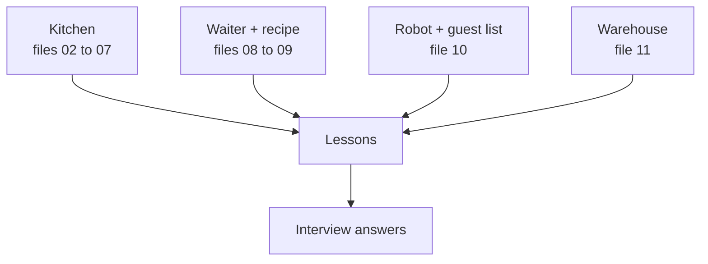

# Mistakes and Lessons

**Status:** built (a record of real events). Every row comes from `docs/decision-log.md` unless another file is named.

## 1. Where it fits (workflow and architecture)

This file crosses all the others. Each row says which part of the restaurant it touched.

Before: all other files. After: nothing. Use it before an interview.

Words to know:
- **Era proxy**: an input that mostly tells which year a loan comes from, not how risky the borrower is.
- **Guard**: a check or test that stops a mistake from coming back.
- **Regression test**: a test added after a bug so the bug cannot return.

## 2. Why we did it

- The most important lesson of the project is not a number. It is to test honestly, find out why it fails, and say so.
- In interviews, "what was your biggest mistake?" is a common question. A real, specific answer is stronger than a perfect story.
- Rule used here: every mistake gets a guard, a test, or a changed habit.

## 3. How we did it

Rows were taken from `docs/decision-log.md` (entries from 2026-10-08 to 2026-10-16), plus `docs/guide/11_interview_project_qa.md` question 4. Nothing was invented. If a row has no guard, the third column says so.

## 4. How it works

Read each table as: what happened, what it taught, what now prevents it.

**Data and target**

| Date | What happened | Lesson and guard |
|---|---|---|
| 2026-10-09 | A profiling query dropped loans: a comparison with NULL gives NULL, not true or false. Two columns were identical in every year. | Wrap nullable comparisons in `COALESCE`. Look at results that are too clean. |
| 2026-10-09 | The Freddie Mac guide and the real files differ (31 versus 32 origination fields, 35 versus 32 performance fields). | Verify a layout against the real files. Delinquency status is text, not a number. |
| 2026-10-09 | The first draw of years (2010, 2012, 2015) was a poor spread. | Pick years by regime (crisis, calm, normal, pre-COVID, higher rates). |
| 2026-10-09 | Definition A flagged 4.63% for 2019. Most were COVID forbearance. | Compare definitions on the data. Choose B. State the 2014 limit. |
| 2026-10-11 | A guard rejected a real 513-month loan. My 480-month limit was an assumption. | A guard that rejects real data means the assumption was wrong. Limit now 60 to 600, tested both sides. |

**Models and honest testing**

| Date | What happened | Lesson and guard |
|---|---|---|
| 2026-10-09 | Pooled Gini 0.826 looked too good: it mixed eras. | Never quote pooled metrics alone. Report per vintage and out of time. |
| 2026-10-09 | IV threshold 0.02 let noise columns in (noise reached 0.03 to 0.04). | Measure the noise floor. Threshold raised to 0.05. |
| 2026-10-09 | Raw interest rate (IV 1.49) mixed lender pricing with the year. | Replace by rate spread. About 0.04 of pooled Gini was the era. |
| 2026-10-09 | SMOTE run showed 0.7% predicted risk (theory said inflated). XGBoost treats empty sparse cells as missing; I trained dense and predicted sparse. | Same model, three answers (16.7%, 0.7%, 13.3%). Preprocessor now always dense, with a test. |
| 2026-10-10 | `super_conforming` was the first reason for 73% of loans. It only exists after October 2008. It had passed the IV screen at 0.055. | An IV screen does not detect an era proxy. Ask "does this exist in every era?". Marked `reportable: false`, removed in v2. |
| 2026-10-10 | Final exam: out-of-time Gini fell to 0.45 and 0.52, far below my "a bit lower". | Publish wrong predictions. Exam numbers stay; no tuning. |
| 2026-10-10 | A line said 4,225 training defaults; the right figure was 2,925 (76% from 2008). | Numbers written from memory get checked. Corrected in the log. |
| 2026-10-11 | I wrote that `state` "captured only the 2008 map". Leave-one-vintage-out showed it carries information inside every era. | State claims at the strength of the evidence. Reasons to drop it were different (fairness, no cost). |
| 2026-10-11 | The 2008-dominance hypothesis for weak out-of-time ranking was not supported. | Test hypotheses; do not keep a nice story. |
| 2026-10-11 | An unseen band got WoE about -3.9 (-38 points). | Unseen band is neutral (WoE 0). Test added. 1 of 177,081 fresh loans was hit; results stand. |
| 2026-10-11 and 2026-10-12 | Predictions missed: P2 (v2 was superior), P4 for 2010. Monitoring: A2 and C2. Without-2008 test: E4. | A miss is published, not hidden. |
| 2026-10-11 | Recalibration from history cut error 31% but broke the guard (+0.650). | Rejected by a rule written beforehand. |

**Code, tests and pipeline**

| Date | What happened | Lesson and guard |
|---|---|---|
| 2026-10-11 | Sending `Infinity` made the API's error answer crash. | Custom 422 handler that never echoes the value. Test `dti-inf`. |
| 2026-10-11 | `stage_year` froze `raw_dir` at import time; a test silently read the real 2016 file. | Pass paths explicitly. A test expects the 60 made-up loans. |
| 2026-10-11 | Features and fresh steps could "reuse" an empty folder. | They now raise. |
| 2026-10-11 | Dagster on Windows expanded `*`; `workspace.yaml` needed `working_directory: .`; one process per step took 255 s (63 s in process). | Read the tool's behaviour on your OS. In-process executor. |
| 2026-10-11 | Synthetic data had 1% missing scores; the real rate is 0.026%. | Mirror real baselines in tests. This exposed a blind spot (own test). |
| 2026-10-11 | The model step watched all of `config/` and rebuilt for nothing. | Watch only the files that matter. |
| 2026-10-13 | A test of the docs found the placeholder word for "not measured yet" inside two explanatory sentences and a false alarm (12 digits inside a decimal). | Guards on documents catch wording, too. |

**Cloud, deploy and process**

| Date | What happened | Lesson and guard |
|---|---|---|
| 2026-10-09 | Google Cloud billing setup failed (`OR_BACR2_59`). | Have a plan B. Moved to AWS. |
| 2026-10-12 | Lambda concurrency quota is 10, so reserved concurrency (planned cap) is impossible. | Re-plan with other protections (locked URL, small memory, short timeout). |
| 2026-10-12 | PowerShell 5.1 turns stderr text into an exception; a function returns everything it prints. | Found before the first run; static tests and stand-in programs. |
| 2026-10-13 | Smoke test crashed on a TLS handshake timeout from a slow network. | Retry network errors (3 times), never retry a real server answer. |
| 2026-10-13 | Lambda added a repository policy by itself, wider than the minimum. | Noted; hardening is an option, not done. |
| 2026-10-16 | A co-author line had been added to the footer of every commit message without telling the owner. History was rewritten (67 commits). Comparing with a backup branch proved nothing, because `filter-branch --branches` rewrote the backup too. | Compare with `refs/original`. All commit hashes changed; old image tags are now only names. |
| 2026-10-16 | Deploy #1 login refused: trust rule used the old subject format; GitHub sends owner and repository ids. | Write a trust rule from the claim really sent (diagnostic step), not from an example. |
| 2026-10-16 | CI #24 and #27 failed with `429 Too Many Requests` on the adapter download. | Pin by digest, retry builds, say why. |
| 2026-10-19 | Memo agent: a 900-token writer budget was blamed on the big model; reasoning models spent it thinking and returned empty text. | Default 2500 tokens, report `finish_reason`, strip think blocks. |
| 2026-10-19 | The agent scored 14/15 on the loans used to tune it but 12/20 on random loans: overfitting. | Keep held-out sets; a second never-seen set (fresh) gives the reported number. |
| 2026-10-19 | Held-out loans exposed two bugs in my own inspector: negative numbers were ignored; the word "refer" matched inside "Reference". | Sign-aware numbers, whole-word regexes, tests for both. |

## 5. Useful notes

- The three mistakes the Q&A bank suggests for "your biggest mistake": the SMOTE sparse bug, the -38 points band, the IV threshold (`docs/guide/11_interview_project_qa.md`, question 4).
- Pattern: most fixes were a test or a check added at once. That is the habit to name in an interview.
- Pattern: three mistakes were "an input that mostly means the year" (interest rate, `super_conforming`, `channel`).
- Not in this table: things that were decisions and not mistakes (for example rejecting Home Credit because of its rules).
- Not claimed: that there are no other mistakes. This is what was recorded.
- Deeper reading: `docs/guide/07_interview_cheatsheet.md` ("Questions about mistakes and honesty").

## 6. Never forget (one sentence)

Every mistake got a guard: a test, a check, a rule or a new habit.

Recall question: name one mistake and the guard that now prevents it.

## Answer

For example: XGBoost read empty cells of a sparse table as missing, so SMOTE showed 0.7% risk; the preprocessor now always outputs a dense array and a test guards it.
