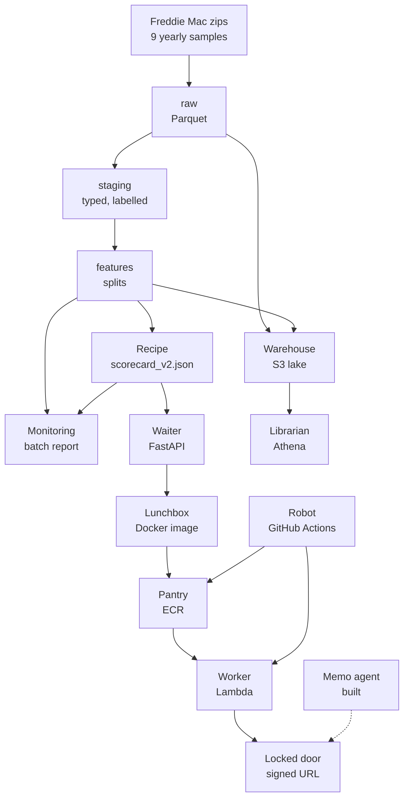

# Walkthrough: the whole project, one part at a time

This folder explains the Credit Risk Platform from zero.
It is written for someone who is new to finance, cloud and data engineering.
Sentences are short. Every technical word is explained the first time it appears in each file.
Every number comes from a file in the repo, and the file is named next to it.

## How to read it

Read the files in order. Each file has the same six headings:
1. Where it fits. 2. Why we did it. 3. How we did it. 4. How it works. 5. Useful notes. 6. Never forget (one sentence and one recall question).

| # | File | What you learn |
|---|---|---|
| 01 | `01_big_picture_and_architecture.md` | The whole restaurant in one page |
| 02 | `02_data_and_medallion_layers.md` | Freddie Mac data, raw, staging, features, exclusions, splits |
| 03 | `03_target_labels_and_honest_testing.md` | What "default" means, freezing, pre-registration, one exam |
| 04 | `04_models_scorecard_vs_xgboost.md` | The points model, the challenger, calibration, results |
| 05 | `05_money_fairness_model_card.md` | Loss, cut-off, expected loss, fairness, reason codes |
| 06 | `06_monitoring_and_drift.md` | PSI, CSI, level ratio, fire drills, the rejected fix |
| 07 | `07_pipeline_orchestration_dagster.md` | One command that runs the kitchen |
| 08 | `08_serving_model_file_and_api.md` | The 7 KB recipe and the strict waiter |
| 09 | `09_container_and_lambda.md` | The lunchbox, the sleeping worker, the locked door |
| 10 | `10_ci_and_automatic_deploy_oidc.md` | The robot, the guest list, the refused login |
| 11 | `11_data_lake_s3_athena.md` | The warehouse, the librarian, the 200 MB cap |
| 12 | `12_llm_memo_agent.md` | The chef, the writer and the inspector: a memo writer checked by code |
| 13 | `13_mistakes_and_lessons.md` | Every real mistake and what it taught |

Deeper reading (the older learning guide): `docs/guide/README.md`. Every decision with its evidence: `docs/decision-log.md`.

## The analogies used in every file (learn these once)

| Real thing | Picture |
|---|---|
| Project | A restaurant |
| Data pipeline + model building (on the laptop) | The kitchen |
| `models/scorecard_v2.json` (the scorecard model file) | The recipe |
| FastAPI code in `service/` | The waiter |
| AWS Lambda (runs code only when called) | A sleeping worker who wakes when someone knocks |
| Container image (Docker) | The worker's lunchbox. Updating a Lambda = swapping the lunchbox |
| Amazon ECR (image storage) | The pantry |
| Function URL with signed requests | The locked door |
| Lambda Web Adapter | The translator between the door and the waiter |
| GitHub Actions | The robot that carries lunchboxes |
| S3 lake + Athena | The warehouse + the librarian |
| AWS role | A uniform |
| Role trust rule | The guest list: who may put the uniform on |
| Role permissions | What the uniform may do |

## One-page architecture

The dotted arrow is not built. The API does not read from the lake. Monitoring runs on request, not live.

## What runs where

| Place | What runs there | Proof in the repo |
|---|---|---|
| Your laptop | Download of the Freddie Mac zips (by hand), the Dagster pipeline, model building, the exams, the monitoring report, the `infra/*.ps1` scripts (you run them), `scripts/lake_sync.py`, `scripts/measure_latency.py`, the tests | `pipeline/`, `credit/`, `infra/`, `scripts/` |
| GitHub | `ci.yml` on every push: style check, 308 tests, image build, image content check, container smoke test. `deploy.yml` on a push to `main`: the same checks first, then the deploy. No data is stored there | `.github/workflows/` |
| AWS (region `eu-north-1`) | ECR repository, Lambda function with a locked Function URL, two IAM roles (one for Lambda, one for the GitHub deploy), the GitHub OIDC trust entry, CloudWatch logs, a private S3 bucket, a Glue database, an Athena workgroup | `infra/README.md` |

The raw Freddie Mac data is never in git, never on GitHub and never in a public place (Freddie Mac terms).

## Timeline (dates from `docs/decision-log.md`)

| Date | Stage |
|---|---|
| 2026-10-08 | Dataset chosen: Freddie Mac (Kaggle Home Credit rejected because of its rules) |
| 2026-10-09 | AWS chosen (Google Cloud billing setup failed). AWS account secured. Target defined (definition B), exclusions, staging, features, splits, baseline, XGBoost, calibration, ablation, WoE scorecard, rate spread |
| 2026-10-10 | Final exam (run once). LGD measured. Cut-off and expected loss. Reason codes. Fairness slices |
| 2026-10-11 | Model v2: era review, pre-registration, exam on 4 fresh years. CI. Model file. API. Dagster pipeline. Monitoring |
| 2026-10-12 | "Without 2008" test. Container built. AWS CLI ready. ECR repository created. Image pushed |
| 2026-10-13 | Lambda function created behind a locked URL. Latency measured. README rewritten |
| 2026-10-16 | S3 lake and Athena parity test (6 of 6). OIDC deploy: first login refused, fixed, Deploy #3 green. 429 rate-limit flake fixed |

## Numbers worth knowing

- 9 yearly samples of 50,000 loans = 450,000 loans (`README.md`).
- Exam on 4 unseen years: Gini 0.628 / 0.599 / 0.543 / 0.595 (`results/v2_exam.md`).
- Over-prediction in calm years: 1.4 to 2.6 times (`docs/model_card.md`).
- Warm request 2.7 ms median, cold start about 1.2 to 1.3 s, 78 MB used of 512 MB (`results/lambda_latency.md`).
- Deploy #3: 162 s in total (`docs/decision-log.md`, 2026-10-16).
- Lake parity: 6 of 6 identical, about 6 MB scanned (`results/lake_parity.md`).
- 308 tests (`pytest --collect-only`, checked while writing this folder).

## Not built (say this out loud in interviews)

- The LLM memo agent. Only a design exists (file 12).
- Automatic rollback. A failed deploy turns red and you roll back by hand (file 10).
- The API reading from the lake. It does not.
- Live monitoring. Monitoring is a batch report.
- A public demo URL. There is none on purpose.
